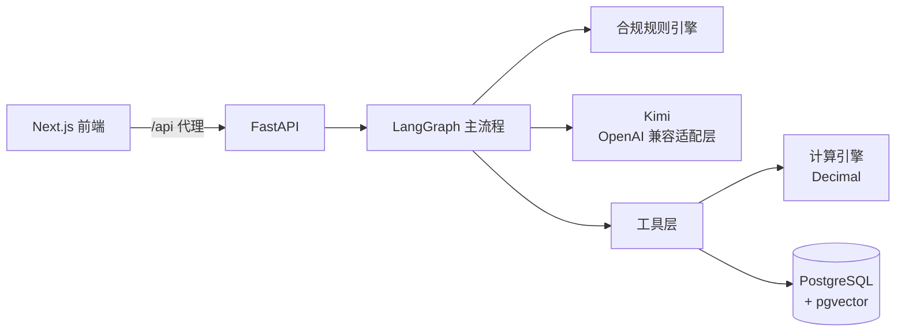

# WealthPilot AI

面向中国银行理财市场的 AI 理财助手：以 AI 为第一服务入口，必要时转交理财经理（AI-First + Human-in-the-Loop）。

> **作品集演示系统**：使用虚构客户与标注过的样本数据，不销售任何产品，不接触真实资金，不构成投资建议。

## 设计要点

- **合规不靠 Prompt**：适当性规则写在代码里，分三道防线：流程门禁、工具自检、输出审查。未完成风险测评时，LLM 根本拿不到产品查询工具。
- **数字不靠 LLM**：所有金额由 `Decimal` 计算引擎算出；图表数据直接来自工具输出，不经过模型改写。
- **话题路由控制成本**：与理财无关的问题用固定话术回复，不调用主模型。
- **人工交接是状态机**：客户同意、待接单、处理中等状态都来自真实工作流，界面不会把"待接单"说成"已接入"。

## 架构



| 层 | 技术 |
|---|---|
| 前端 | Next.js 16、React 19、TypeScript、Tailwind CSS 4、Recharts |
| 后端 | Python 3.13、FastAPI、Pydantic、SQLAlchemy 2、Alembic |
| Agent | LangGraph（单主 Agent + 强类型工具） |
| 模型 | Kimi（Moonshot，经适配层可替换） |
| 数据 | PostgreSQL 16 + pgvector |
| 工具链 | uv、pytest、ruff、Docker Compose |

详见 [docs/ARCHITECTURE.md](docs/ARCHITECTURE.md)，其中包括 12 条架构决策及其取舍。

## 快速开始

前置条件：Docker、[uv](https://docs.astral.sh/uv/)、Node.js 20+、Kimi API Key。

```bash
cp .env.example .env          # 填写 LLM_API_KEY
./scripts/dev.sh              # 一键启动数据库、后端、前端 → http://localhost:3000
```

真实公开产品文件（PDF）不入库，需要时从官方来源下载并校验：

```bash
cd backend && uv run python ../scripts/fetch_documents.py
```

也可以分步手动启动：

```bash
# 1. 数据库
docker compose up -d db

# 2. 后端（uv 会自动创建 .venv 虚拟环境）
cd backend
uv sync
uv run alembic upgrade head
uv run python scripts/check_llm.py   # 检查 Kimi 连通性与工具调用
uv run uvicorn app.main:app --reload

# 3. 前端（另开终端）
cd frontend
npm install
npm run dev                    # http://localhost:3000
```

一键启动全部服务：`docker compose up --build`

## 测试

```bash
cd backend && uv run pytest     # 计算、问卷计分、合规规则、Agent 流程（假模型）、API 集成（需数据库）
cd backend && uv run python ../evaluations/run_router_eval.py   # 用真实 Kimi 评估话题路由
cd frontend && npm run lint && npm run build
```

## 项目结构

```text
backend/
  app/calculations/   纯函数金融计算（不依赖 LLM）
  app/tools/          暴露给 LLM 的工具（校验 → 计算 → UI 块）
  app/agent/          LangGraph 图与 Prompt
  app/api/            REST 接口
  app/db/             数据模型；migrations/ 为 Alembic 迁移
  tests/              单元、流程、集成测试
frontend/src/
  components/blocks/  测算凭证、折线图等结构化回答组件
docs/                 架构、合规、评估、路线图
```

## 进度

| 阶段 | 状态 |
|---|---|
| P0 设计文档 | ✅ |
| P1 骨架 + 计算器链路 | ✅ 已用真实 Kimi（kimi-k2.6）端到端验证 |
| P2 风险测评门禁 + 规则引擎 | ✅ 话题路由评估 24/24 |
| P3 产品库 | 下一步 |
| P4–P7 | 见 [docs/ROADMAP.md](docs/ROADMAP.md) |
