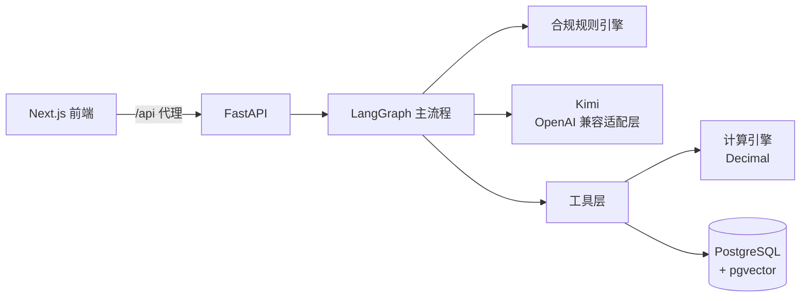

# WealthPilot AI

面向中国银行理财市场的 AI 理财助手：以 AI 为第一服务入口，必要时转交理财经理（AI-First + Human-in-the-Loop）。

> **作品集演示系统**：使用虚构客户与标注过的样本数据，不销售任何产品，不接触真实资金，不构成投资建议。

## 设计要点

- **合规不靠 Prompt**：适当性规则写在代码里，分三道防线：流程门禁、工具自检、输出审查。未完成风险测评时，LLM 根本拿不到产品查询工具。
- **数字不靠 LLM**：所有金额由 `Decimal` 计算引擎算出；图表数据直接来自工具输出，不经过模型改写。
- **话题路由控制成本**：与理财无关的问题用固定话术回复，不调用主模型。
- **会推荐，但不硬推销**：测评后按客户的期限、流动性需求匹配评级范围内的产品并说明理由，产品卡片可直接进入买入确认；推荐超评级产品、制造紧迫感、以收益为理由都会被输出审查拦截。买入由客户本人确认，服务端逐项校验（演示只到确认页，不下单）。
- **适当性是硬过滤**：超出评级、已到期、金额或期限不符的产品进不了候选；排序只看期限、流动性和费用，不按收益排序。客户评级由系统注入，模型无法改写。
- **回答有出处**：金融常识以人工编写、法规原文已核对的知识库为依据，回答标注 [K17] 这类编号并可展开查看原文与官方链接；没有依据的回答标注「一般性说明」。知识库条目过期自动停止引用。
- **客户画像叠加而不重建**：基础画像来自银行系统、只读；对话中的新需求（金额、期限、流动性、目标收益）另行记录并标注来源，已知信息不再追问。
- **质量可重复验证**：25 个真实 LLM 多轮场景（门禁、诱导、推荐、权益、新品、产品、引用、计算、交接），确定性检查 + LLM 评审，每个场景重复运行统计通过率；CI 每次提交运行全部单元与集成测试。
- **像营销人员一样工作，但守住合规**：客户问奖励或计划资金可达更高等级时，提示贵宾等级权益与活动（只与资产总额挂钩，不「买理财送礼」）；有配置需求时介绍评级范围内的新品，客户同意后设置开售提醒，购买仍由本人完成。权益、活动、新品都来自数据，AI 引用的收益数字必须有来源。
- **语音输入**：按住麦克风说话，本地开源模型（SenseVoice）转成文字后填入输入框，确认再发送；录音不离开本机、不保存；回答可一键朗读。
- **按真实金融应用的标准做安全**：服务端会话（httpOnly Cookie、可即时吊销）、客户与理财经理角色隔离、登录与对话限流、跨站写请求拦截、安全响应头、日志脱敏、CI 依赖漏洞扫描；每条防护都有对应测试（[威胁模型](docs/SECURITY.md)）。
- **联系理财经理**：客户看到专属理财经理名片（企业微信、电话），咨询要点由代码生成并同步到理财经理看板；AI 不会声称理财经理「已联系您」。

## 架构



| 层 | 技术 |
|---|---|
| 前端 | Next.js 16、React 19、TypeScript、Tailwind CSS 4、Recharts |
| 后端 | Python 3.13、FastAPI、Pydantic、SQLAlchemy 2、Alembic |
| Agent | LangGraph（单主 Agent + 强类型工具） |
| 模型 | Kimi（Moonshot，经适配层可替换） |
| 数据 | PostgreSQL 16 + pgvector |
| 工具链 | uv、pytest、ruff、Docker Compose |

详见 [docs/ARCHITECTURE.md](docs/ARCHITECTURE.md)，其中包括 12 条架构决策及其取舍。

## 快速开始

前置条件：Docker、[uv](https://docs.astral.sh/uv/)、Node.js 20+、Kimi API Key。

```bash
cp .env.example .env          # 填写 LLM_API_KEY
./scripts/dev.sh              # 一键启动数据库、后端、前端 → http://localhost:3000
                               # 演示账号：wang / chen（客户）、li / zhou（理财经理），密码 wealthpilot-demo
```

也可以分步手动启动：

```bash
# 1. 数据库
docker compose up -d db

# 2. 后端（uv 会自动创建 .venv 虚拟环境）
cd backend
uv sync
uv run alembic upgrade head
uv run python scripts/check_llm.py   # 检查 Kimi 连通性与工具调用
uv run uvicorn app.main:app --reload

# 3. 前端（另开终端）
cd frontend
npm install
npm run dev                    # http://localhost:3000
```

一键启动全部服务：`docker compose up --build`

## 测试

```bash
cd backend && uv run pytest     # 计算、问卷计分、合规规则、Agent 流程（假模型）、API 集成（自动使用独立测试库 wealthpilot_test）
cd backend && uv run python ../evaluations/run_scenarios.py --repeat 3   # 真实 Kimi 多轮场景评估，报告写入 evaluations/reports/
cd backend && uv run python ../evaluations/run_router_eval.py   # 用真实 Kimi 评估话题路由
cd backend && uv run python ../evaluations/run_rag_eval.py      # 检索命中率（不调用 LLM）
cd backend && uv run python ../scripts/check_knowledge.py       # 知识库维护检查（核对法规原文）
cd frontend && npm run lint && npm run build
```

语音输入需要本地识别模型（约 240MB，`./scripts/dev.sh` 首次启动时自动下载，也可手动运行 `cd backend && uv run python ../scripts/download_asr_model.py`；国内网络可设置 `HF_ENDPOINT=https://hf-mirror.com`）。未下载时麦克风按钮不显示，其他功能不受影响。

CI（`.github/workflows/ci.yml`）在每次 push / PR 时运行后端 ruff + pytest 与前端 lint + build。场景评估调用真实模型、有费用，不在 CI 中运行。

## 项目结构

```text
backend/
  app/calculations/   纯函数金融计算（不依赖 LLM）
  app/tools/          暴露给 LLM 的工具（校验 → 计算 → UI 块）
  app/agent/          LangGraph 图与 Prompt
  app/api/            REST 接口
  app/db/             数据模型；migrations/ 为 Alembic 迁移
  tests/              单元、流程、集成测试
frontend/src/
  components/blocks/  测算凭证、折线图等结构化回答组件
docs/                 架构、合规、评估、路线图
```

## 进度

| 阶段 | 状态 |
|---|---|
| P0 设计文档 | ✅ |
| P1 骨架 + 计算器链路 | ✅ 已用真实 Kimi（kimi-k2.6）端到端验证 |
| P2 风险测评门禁 + 规则引擎 | ✅ 话题路由评估 24/24 |
| P3 产品库与适当性 | ✅ 16 个虚构产品；132 个测试 |
| P4 条款 RAG + 知识库 | ✅ 检索 Hit@1 96%；52 条法规摘录自动核对通过 |
| P5 客户画像 + 配置情景 | ✅ 基础画像（银行系统）+ 本次需求；主场景跑通 |
| P6 人工交接 | ✅ 客户同意 → 理财经理看板 → 服务中 AI 暂停，全程留痕 |
| P7 质量与完善 | 🔄 场景评估、测试隔离、CI、最近对话 |
