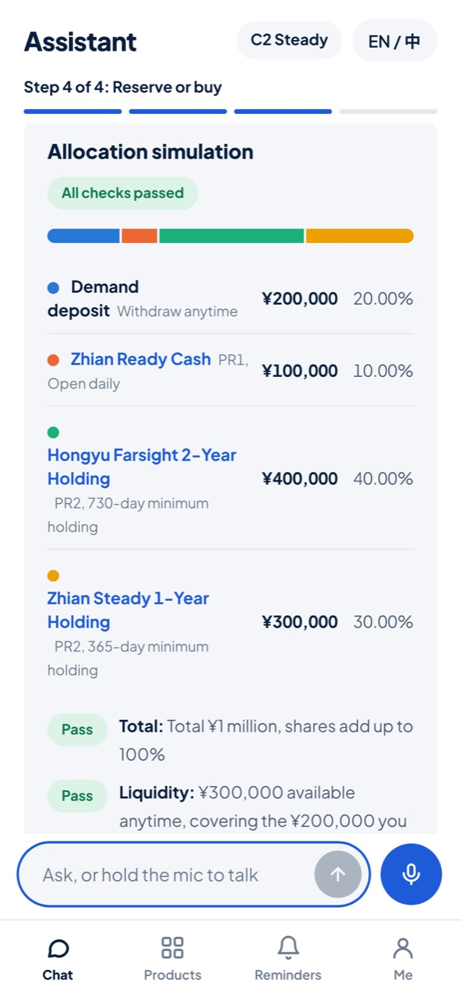
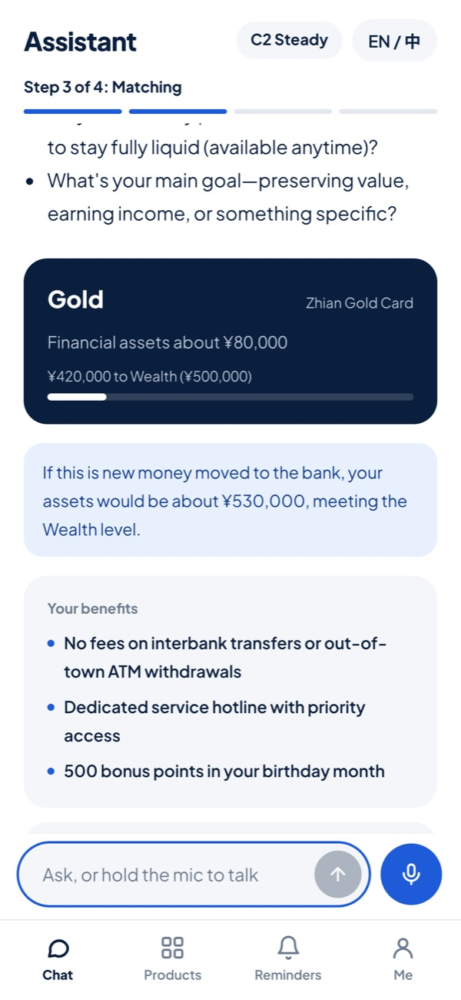
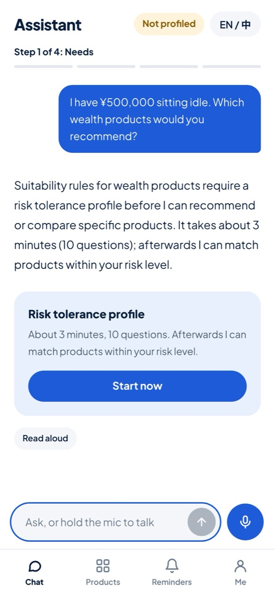
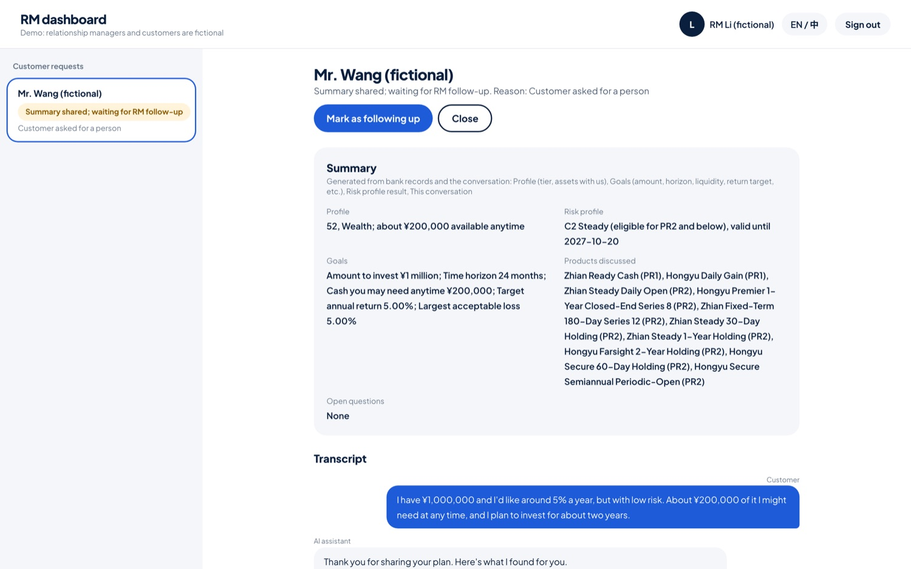
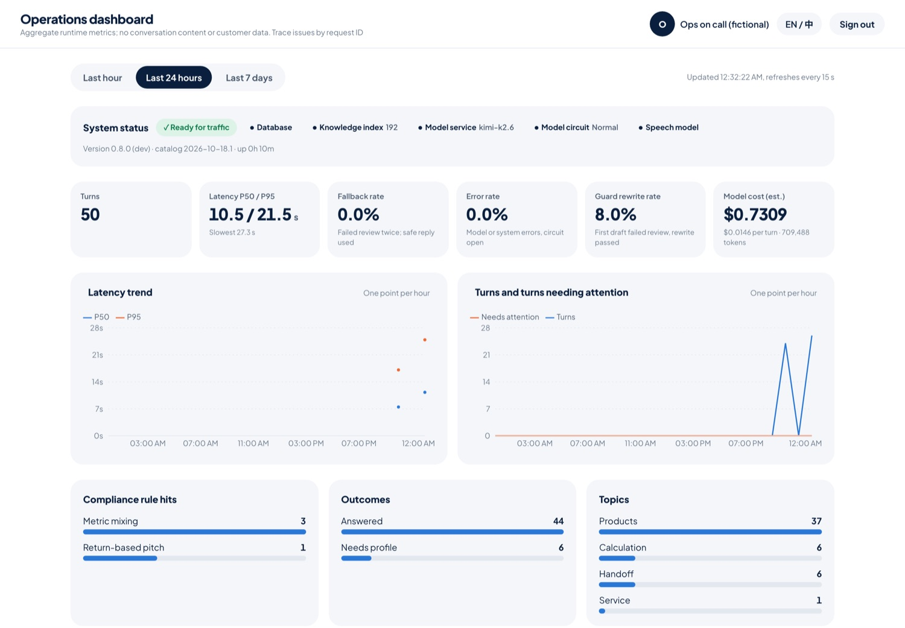
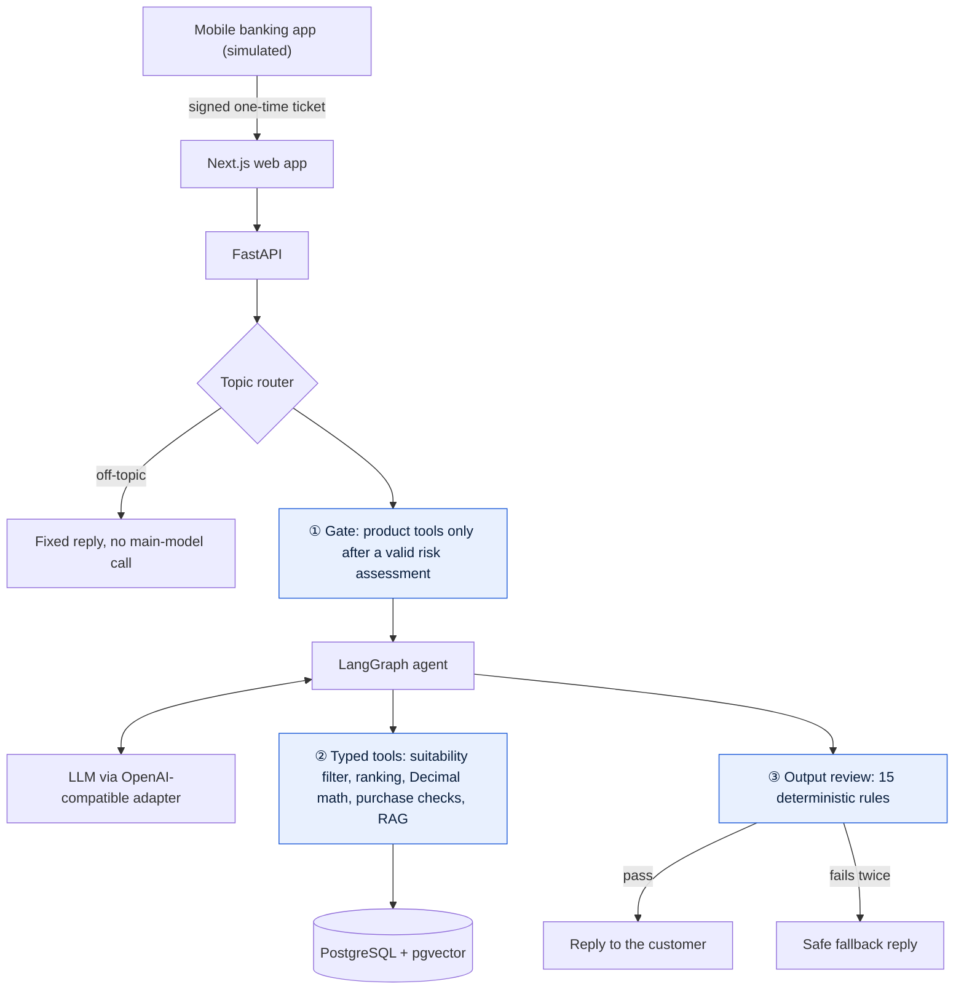

<div align="center">


<h1>WealthPilot AI</h1>

<p><strong>A bank wealth assistant that gets things done.</strong><br>
Timely product information, expert answers and personalized wealth plans, available any time.<br>
Under strict compliance controls, it lifts wealth-product conversion and brings new assets to the bank.</p>

<p>
<a href="https://github.com/Zeye430/WealthPilot_Agent/actions/workflows/ci.yml"></a>


</p>

<p>
<a href="#demo">Demo</a> ·
<a href="#highlights">Highlights</a> ·
<a href="#how-it-works">How it works</a> ·
<a href="#evaluation">Evaluation</a> ·
<a href="#quick-start">Quick start</a>
</p>

<p><strong>English</strong> · <a href="README.zh-CN.md">简体中文</a></p>

</div>

> [!NOTE]
> **Portfolio project.** All institutions, products and customers are fictional and labeled as synthetic. Nothing is sold and no real money moves: the purchase flow stops at a confirmation page. Not investment advice.

## Why this project

**Customer pain points**

- **The chatbot can't help.** Most banking apps have a customer-service bot that answers fixed questions. Ask "I have ¥200,000 I won't need for a year, what should I buy?" and it hands you off to a human.
- **No one to reach.** Relationship managers aren't always available, and even less so after hours.
- **Slow, uneven answers.** When you do reach someone, they may need time to look things up and run the numbers, and expertise varies from person to person.
- **Hard-to-read information.** Product documents are long and use different yield measures (7-day annualized yield, performance benchmark), so comparing products is hard.

**Bank pain points**

- **Not enough people.** Relationship managers can only focus on a small number of high-net-worth clients; most customers get little timely wealth advice.
- **Lost conversions.** Slow answers mean customers miss the moment to buy, and money sits in checking accounts or moves elsewhere.
- **Poorly timed outreach.** Customers often don't know about new products, campaigns or tier benefits, and notifying them one by one is hard to time well.
- **Compliance risk.** Human advice varies and can mislead. A general-purpose LLM is no fix: it may promise returns or recommend unsuitable products.

**Our approach**

WealthPilot is a wealth assistant that gets things done:

- **Always available, always consistent.** It knows the products, runs the numbers and builds plans, giving every customer timely, expert answers with one consistent voice.
- **Proactive.** At the right moment it mentions new products, campaigns and tier benefits, lifting wealth-product conversion and asset inflows.
- **Focused on wealth management.** Ideally, a bank's AI assistant could handle many kinds of business. This project focuses on the highest-value piece: wealth advice and planning.
- **Compliance enforced in code.** Wealth management is heavily regulated. Code, not the model, decides the risk rating, which products can be recommended and whether a purchase is allowed.

<h2 id="demo">Demo</h2>

<!-- Demo video: drag the compressed mp4 (under 10 MB) into GitHub's README editor here. Shot list in the local design docs. -->

<table>
<tr>
<td align="center" width="33%"></td>
<td align="center" width="33%"></td>
<td align="center" width="33%"></td>
</tr>
<tr>
<td align="center" valign="top"><strong>Smart planning</strong><br><sub>"I have ¥1,000,000, want about 5% a year with low risk, and may need ¥200,000 any time." It builds an allocation and checks totals, liquidity and fees line by line.</sub></td>
<td align="center" valign="top"><strong>Drives conversion</strong><br><sub>A Gold customer plans to move in ¥450,000. The assistant shows this would reach the Wealth tier and lists the benefits that come with it.</sub></td>
<td align="center" valign="top"><strong>Risk control</strong><br><sub>An unprofiled customer asks for recommendations. No products are offered until the risk assessment is done.</sub></td>
</tr>
</table>

<table>
<tr>
<td align="center" width="50%"></td>
<td align="center" width="50%"></td>
</tr>
<tr>
<td align="center" valign="top"><strong>Relationship manager dashboard</strong><br><sub>Leads handed off by the AI arrive with the customer's goals, risk profile, products discussed and full transcript. The manager marks follow-up in one click.</sub></td>
<td align="center" valign="top"><strong>Operations dashboard</strong><br><sub>Latency, fallback rate, compliance rule hits and cost per turn. No conversation content or customer IDs.</sub></td>
</tr>
</table>

<h2 id="highlights">Highlights</h2>

<table>
<tr>
<td width="50%" valign="top">

**Full-featured**<br>
Product and terms Q&A with cited sources, needs-based matching, return and fee calculations, allocation simulation, and a path from recommendation to purchase confirmation. When a person is needed, it hands off to the customer's relationship manager with a summary.

</td>
<td width="50%" valign="top">

**Drives conversion, never hard-sells**<br>
It prompts at the right moment: upcoming products within the customer's rating when they have money to place, with a sale reminder once they agree; the benefits they'd unlock if planned money lifts them to a higher tier; current campaigns. Timelier service lifts conversion and asset inflows.

</td>
</tr>
<tr>
<td valign="top">

**Compliance by design**<br>
Three layers: a risk assessment before any recommendation, products above the customer's rating filtered out before ranking, and 15 output rules that block promised returns, pressure tactics and return-based pitches. Every compliance decision is made in code.

</td>
<td valign="top">

**Trustworthy answers**<br>
Amounts are calculated in code, never by the model. Product facts come only from the catalog. General answers cite their sources. 25 scenarios per language are re-run after every change, and reports keep the failures.

</td>
</tr>
<tr>
<td valign="top">

**Secure by default**<br>
Entry from the banking app with a one-time signed ticket; separate roles for customers, relationship managers and operations; rate limits and log redaction. Every control in the threat model has a test.

</td>
<td valign="top">

**Built to operate**<br>
A live ops dashboard for latency, fallback rate and rule hits; an automatic circuit breaker when the model fails; graceful timeouts; load-tested; one-command deployment with automatic backups.

</td>
</tr>
<tr>
<td valign="top">

**Cost-efficient**<br>
About $0.011 per turn, measured. Off-topic questions get a fixed reply without calling the main model. Tokens and cost are tracked for every turn.

</td>
<td valign="top">

**Native to the banking app**<br>
Runs as a module inside the mobile banking app. Mobile-first, fully bilingual in Chinese and English, with voice input.

</td>
</tr>
</table>

<h2 id="how-it-works">How it works</h2>



The model sits in the middle of the pipeline, but never at a decision point. The three numbered layers are deterministic code:

| Layer | What it enforces | Example it stops |
|---|---|---|
| **1. Gate** | Without a valid risk assessment, product tools aren't bound to the model at all | "Which products should I buy?" from an unprofiled customer |
| **2. Tool checks** | Products above the customer's rating are filtered out before ranking. The customer's ID and rating are injected, so the model can't see or change them | A prompt injection asking to "treat me as aggressive" |
| **3. Output review** | 15 deterministic rules in Chinese and English: guarantees, pressure tactics, unsourced products, figures or amounts, mixed yield measures, false action or handoff claims | "This product guarantees 5%", or an amount the model computed itself |

A reply that fails review is rewritten once with specific feedback. If it fails again, the customer gets a safe fallback. A rejected draft never counts as evidence for its own rewrite.

<details>
<summary><strong>Tech stack</strong></summary>

<br>

| Layer | Stack |
|---|---|
| Frontend | Next.js 16, React 19, TypeScript, Tailwind CSS 4, Recharts |
| Backend | Python 3.13, FastAPI, Pydantic, SQLAlchemy 2, Alembic |
| Agent | LangGraph: one main agent with strongly typed tools |
| Model | Kimi K2.6 by default. Pluggable through config: presets for DeepSeek, Qwen and GLM, any OpenAI-compatible API (OpenAI, Ollama, vLLM, ...), Claude, Gemini or Azure OpenAI, with an optional cheaper model for topic routing |
| Data | PostgreSQL 16 + pgvector; local embeddings (fastembed) and speech recognition (SenseVoice) |
| Ops | Docker Compose, Caddy (automatic HTTPS), GitHub Actions, uv, pytest, ruff |

Layers run `api → agent → tools → business modules → db`. Business modules don't depend on the LLM and are tested on their own.

</details>

<h2 id="evaluation">Evaluation</h2>

| What | Result | Notes |
|---|---|---|
| Multi-turn scenarios | **Chinese 73/75 · English 72/75** | 25 real scenarios per language (gate, manipulation, recommendations, rewards, product terms, citations, calculations, handoffs), 3 runs each against the real model |
| Topic routing | **24/24** | Decides whether a question is about wealth management; off-topic questions never reach the main model |
| Knowledge retrieval | **96% top-1 accuracy** | Whether the source an answer needs is found first |
| Load test | **7 → 16 req/s** at 40 concurrent users | Found and fixed a database connection held while waiting for the model |
| Cost | **About $0.011 per turn** | Measured over 289 real conversation turns |
| Automated tests | **390 backend tests** | Run by CI on every commit |

Every evaluation writes a report to [`evaluations/reports/`](evaluations/reports/), **including the replies that failed and why**, not just the successes.

<h2 id="quick-start">Quick start</h2>

You need Docker, [uv](https://docs.astral.sh/uv/), Node.js 20+ and an API key for a model that supports tool calling. Kimi ([platform.kimi.ai](https://platform.kimi.ai)) is the default and the only model evaluated end to end.

<details>
<summary><strong>Using another model</strong></summary>

<br>

Set `LLM_PROVIDER` and `LLM_API_KEY` in `.env`; `.env.example` lists every option.

| Provider | `LLM_PROVIDER` | Also set |
|---|---|---|
| Kimi, DeepSeek, Qwen, GLM | `kimi` / `deepseek` / `qwen` / `glm` | Nothing else: base URL and model have defaults, and each vendor's way of turning thinking off is applied |
| Other OpenAI-compatible APIs (OpenAI, Ollama, vLLM, ...) | `openai_compatible` | `LLM_BASE_URL`, `LLM_MODEL` |
| Claude | `anthropic` | `LLM_MODEL` |
| Gemini | `gemini` | `LLM_MODEL` |
| Azure OpenAI | `azure_openai` | `LLM_BASE_URL` (endpoint), `LLM_MODEL` (deployment), `LLM_API_VERSION` |

`LLM_ROUTER_MODEL` can point topic routing at a cheaper model (e.g. `qwen-flash`). Then run `cd backend && uv run python scripts/check_llm.py` for a smoke test, re-run the scenario evaluation, and set `LLM_PRICE_*` to the model's prices; until you do, the readiness check flags that cost tracking still uses Kimi's prices.

</details>

```bash
git clone https://github.com/Zeye430/WealthPilot_Agent.git && cd WealthPilot_Agent
cp .env.example .env          # set LLM_API_KEY
./scripts/dev.sh              # database, backend and frontend → http://localhost:3000
```

Or run everything in containers: `docker compose up --build`.

Open **http://localhost:3000/bank**, sign in to the simulated banking app and tap **AI wealth assistant**. Switch languages with **中 / EN**.

<details>
<summary><strong>Demo accounts</strong> (local only; password <code>wealthpilot-demo</code>)</summary>

<br>

| Account | Role | Where |
|---|---|---|
| `wang`, `chen` | Customers | `/bank` or `/login` |
| `li`, `zhou` | Relationship managers | `/rm` |
| `ops` | Operations | `/ops` |

</details>

<details>
<summary><strong>Tests and evaluation</strong></summary>

<br>

```bash
cd backend && uv run pytest                                                          # no API key needed
cd backend && uv run python ../evaluations/run_scenarios.py --suite en --repeat 3   # real model, about $2 per suite
cd backend && uv run python ../evaluations/run_router_eval.py
cd backend && uv run python ../evaluations/run_rag_eval.py
cd frontend && npm run lint && npm run build
```

On every push, CI runs the backend tests, linting and dependency audits, builds the frontend, and boots the full production stack with a fake model to check HTTPS, readiness, blocked internal endpoints, the access code and the image contents.

</details>

## Deployment

`deploy/` holds a production setup for one AWS Lightsail server (from $12 a month): database, backend, frontend, Caddy with automatic HTTPS, and daily backups.

```bash
DRY_RUN=1 ./deploy/deploy.sh   # print every AWS and server command without creating anything
./deploy/deploy.sh             # about 15 minutes later: https://<ip>.sslip.io
./deploy/update.sh             # ship the latest commit (backs up the database first)
./deploy/destroy.sh            # export the database locally, then delete the server
```

<details>
<summary><strong>Before the first deploy</strong></summary>

<br>

1. In AWS IAM, create a user with Lightsail-only permissions, create an access key for it, and run `aws configure`. Use the access key, never the account password.
2. `cp deploy/.env.production.example deploy/.env.production` and fill in the model key, passwords and the demo access code. The script refuses to deploy with empty secrets or the default demo password.
3. Leave `DOMAIN` empty to get a free `<ip>.sslip.io` address with HTTPS, or point your own domain's A record at the server's static IP.
4. Use `RAM_GB=4 ./deploy/deploy.sh` for the 4 GB server ($24 a month) if several people will use it at once.

</details>

Inside a bank, the system would look different: it would run in the bank's own network, staff would sign in with single sign-on, and the model would be privately hosted or an approved service.

<details>
<summary><strong>Project layout</strong></summary>

<br>

```text
backend/app/
  compliance/     gate, suitability filter, output review (deterministic)
  calculations/   Decimal financial math, no LLM
  products/       catalog loading and ranking
  purchases/      server-side purchase checks (stops at confirmation)
  agent/          LangGraph graph and prompts
  tools/          typed tools exposed to the model
  rag/            knowledge base retrieval (pgvector)
  handoff/        relationship-manager handoff state machine
  bank_sim/       simulated mobile banking app (kept separate from WealthPilot)
frontend/src/     customer app, RM and ops dashboards, simulated banking app
data/             fictional products, customers, rewards and knowledge base
evaluations/      scenario suites (zh/en) and reports
deploy/           production compose, Caddy and deploy scripts
```

</details>

## Disclaimer

WealthPilot is a portfolio project. Zhian Bank (知岸银行), Zhian Wealth Management (知岸理财) and Hongyu Wealth Management (鸿屿理财) are fictional, as are all products and customers; any resemblance to real institutions is unintended. Nothing here is investment, legal or compliance advice.
