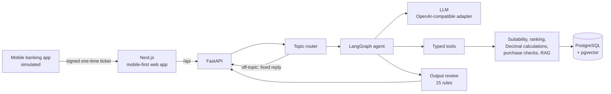

# WealthPilot AI

English | [中文](README.zh-CN.md)

An AI wealth assistant for retail customers of Chinese banks. Customers open it from their mobile banking app to plan, ask questions and find products that fit their needs. When a question needs a person, the assistant hands off to the customer's relationship manager.

**The core design choice: compliance decisions live in deterministic code, not in the prompt.** The language model never decides a customer's risk rating, which products are eligible, whether a purchase is allowed or whether a human has taken over. It only reads those facts. Every reply passes 15 output rules in code before the customer sees it.

> **Portfolio project.** All institutions, products and customers are fictional and labeled as synthetic. Nothing is sold and no real money is involved: the purchase flow stops at a confirmation page. This is not investment advice.

<!-- Demo video: drag the compressed mp4 (under 10 MB) into GitHub's README editor here. Shot list: docs/DEMO_SCRIPT.md -->

## What it does

| | |
|---|---|
| **Plans and matches** | Learns the customer's amount, time horizon and liquidity needs, then suggests products within their risk rating, with reasons based on term, liquidity, fees and minimums. |
| **Answers questions** | Explains wealth-management concepts from a hand-written knowledge base whose regulation excerpts are checked against the source. Answers cite entries like [K17], which expand to the original text. |
| **Calculates** | Compound growth, fees and allocation scenarios, all computed in code with `Decimal`. Charts come straight from tool output. |
| **Hands off** | Shares a summary with the relationship manager when the customer agrees. The handoff is a state machine, and the AI can never claim a human has joined. |
| **Works like the real channel** | Opened from a simulated mobile banking app with a signed one-time ticket. Mobile-first web app, fully bilingual (Chinese and English), with voice input transcribed on our own server. |

## Design highlights

**Compliance in code, three layers deep**
- **Gate.** Before a valid risk assessment, the model isn't given any product tools at all. It can answer general questions and remind the customer to take the assessment.
- **Tool checks.** Products above the customer's rating are hard-filtered before ranking. Ranking never uses returns. The customer's ID and rating are injected into tools, so the model can't see or change them.
- **Output review.** 15 deterministic rules in Chinese and English. They catch guaranteed-return language, pressure tactics, product facts the tools didn't return, amounts that don't come from a tool, comparisons across different yield measures, false claims of actions and handoffs, and more. A failing reply is rewritten once with feedback; if it fails again, a safe fallback is shown. Every decision is logged with a rule version.

**Numbers never come from the model**
All amounts are calculated in code. The output review checks every RMB amount in a reply against tool results, the customer's profile and the knowledge base. The one exception is an illustrative example. It must be a round figure, and the same sentence must say it's an assumption ("Suppose you have ¥600,000 at one bank"). Any result calculated from that example still has to come from a tool.

**Recommends, but doesn't hard-sell**
The assistant is allowed to recommend: it should help customers find suitable products and get to a purchase. But it may not use returns as a selling point, create urgency, tie gifts to specific products or suggest retaking the risk assessment to qualify for riskier products.

**Measured quality**
- 25 multi-turn scenarios per language (gate, manipulation, recommendations, rewards, product terms, citations, calculations, handoffs) run against the real model 3 times each. Checks are deterministic, plus an LLM judge.
- Latest results: Chinese 73/75, English 72/75, with one fallback per language. Each run writes a report to `evaluations/reports/`, failures included.
- Topic routing: 24/24. Retrieval Hit@1: 96%.

**Built to be operated**
- Every request carries an ID through response headers, JSON logs and per-turn metrics (latency, model calls, tokens, cost, tool results, review outcome).
- An ops dashboard shows P50/P95 latency, fallback rate, rule hits and cost, without conversation content or customer IDs.
- Failures behave predictably: a circuit breaker for the model, a 60-second turn budget, tool errors contained, and a fast 503 when overloaded. Each failure mode has a test.
- A load test found that the database connection was held while waiting for the model. Fixing it took throughput at 40 concurrent users from 7 to 16 requests per second.

**Secure by default**
Server-side sessions with httpOnly cookies, role isolation (customer, relationship manager, ops), rate limits, cross-site write checks, log redaction and dependency scanning in CI. Each control has a test; see the [threat model](docs/SECURITY.md).

**Real cost numbers**
From 289 real turns: about $0.011 per turn before caching, with input at 97% of tokens. So the cost levers are prompt caching and context trimming, not shorter answers ([cost estimate](docs/COST_ESTIMATE.md)).

## Architecture



Layers run `api → agent → tools → business modules → db`. Business modules don't depend on the LLM and are tested on their own.

| Layer | Stack |
|---|---|
| Frontend | Next.js 16, React 19, TypeScript, Tailwind CSS 4, Recharts |
| Backend | Python 3.13, FastAPI, Pydantic, SQLAlchemy 2, Alembic |
| Agent | LangGraph: one main agent with strongly typed tools |
| Model | Kimi K2.6 (Moonshot) through an OpenAI-compatible adapter; switching models is a config change plus a re-run of the evaluation |
| Data | PostgreSQL 16 + pgvector; local embeddings (fastembed) and speech recognition (SenseVoice) |
| Ops | Docker Compose, Caddy (automatic HTTPS), GitHub Actions, uv, pytest, ruff |

## Run it locally

You need Docker, [uv](https://docs.astral.sh/uv/), Node.js 20+ and a Kimi API key ([platform.kimi.ai](https://platform.kimi.ai)). Any OpenAI-compatible model should work after changing `LLM_BASE_URL` and `LLM_MODEL`; only Kimi has been evaluated.

```bash
cp .env.example .env          # set LLM_API_KEY
./scripts/dev.sh              # database, backend and frontend → http://localhost:3000
```

Or run everything in containers: `docker compose up --build`.

Start at **http://localhost:3000/bank**: sign in to the simulated banking app and open the assistant. Switch to English with the **中 / EN** button.

Demo accounts (local only; password `wealthpilot-demo`):

| Account | Role |
|---|---|
| `wang`, `chen` | Customers |
| `li`, `zhou` | Relationship managers (`/rm`) |
| `ops` | Operations dashboard (`/ops`) |

## Tests and evaluation

```bash
cd backend && uv run pytest                                              # unit, agent flow (fake model), API integration
cd backend && uv run python ../evaluations/run_scenarios.py --suite en --repeat 3   # real-model scenarios (costs about $2 per suite)
cd backend && uv run python ../evaluations/run_router_eval.py             # topic routing
cd backend && uv run python ../evaluations/run_rag_eval.py               # retrieval hit rate
cd frontend && npm run lint && npm run build
```

On every push, CI runs:
- the backend tests, linting and dependency audits;
- the frontend build;
- a boot of the full production stack with a fake model, checking HTTPS, readiness, blocked internal endpoints, the access code and the image contents.

## Deployment

`deploy/` holds a production setup for one AWS Lightsail server (from $12 a month): database, backend, frontend, Caddy and daily backups. With an AWS access key configured, one command creates the server and one removes it:

```bash
DRY_RUN=1 ./deploy/deploy.sh   # print every AWS and server command without creating anything
./deploy/deploy.sh             # about 15 minutes later: https://<ip>.sslip.io
./deploy/update.sh             # ship the latest commit (backs up the database first)
./deploy/destroy.sh            # export the database locally, then delete the server
```

See [docs/DEPLOYMENT.md](docs/DEPLOYMENT.md) (in Chinese). In a bank, the system would run very differently: inside the bank's network, with SSO for staff and a private or approved model. [PRODUCTION_READINESS.md](docs/PRODUCTION_READINESS.md) covers that design and the gap list.

## Documents

| Document | What it covers | Language |
|---|---|---|
| [US_REGULATORY_MAPPING.md](docs/US_REGULATORY_MAPPING.md) | How the controls map to Reg BI, FINRA 2111/2210/3110/4511, SEA 17a-4, Reg S-P and RN 24-09, and what a US pilot would still need | English |
| [ARCHITECTURE.md](docs/ARCHITECTURE.md) | Architecture and 54 decision records with trade-offs | Chinese |
| [COMPLIANCE_DESIGN.md](docs/COMPLIANCE_DESIGN.md) | Gate, suitability filter, all output rules and their history | Chinese |
| [EVALUATION_PLAN.md](docs/EVALUATION_PLAN.md) | Scenario design, checks and results | Chinese |
| [PRODUCTION_READINESS.md](docs/PRODUCTION_READINESS.md) | Production deployment diagram and the demo-to-production gap list | Chinese |
| [COST_ESTIMATE.md](docs/COST_ESTIMATE.md) | Measured cost per turn and projections at scale | Chinese |
| [RUNBOOK.md](docs/RUNBOOK.md) | Incident handling: breaker open, fallback spikes, complaints, key rotation | Chinese |
| [SECURITY.md](docs/SECURITY.md) | Threat model with a test for each control | Chinese |
| [DEVLOG.md](docs/DEVLOG.md) | Step-by-step build log, including problems found and how they were fixed | Chinese |

## Project layout

```text
backend/app/
  compliance/     gate, suitability filter, output review (deterministic)
  calculations/   Decimal financial math, no LLM
  products/       catalog loading and ranking
  purchases/      server-side purchase checks (stops at confirmation)
  agent/          LangGraph graph and prompts
  tools/          typed tools exposed to the model
  rag/            knowledge base retrieval (pgvector)
  handoff/        relationship-manager handoff state machine
  bank_sim/       simulated mobile banking app (kept separate from WealthPilot)
frontend/src/     customer app, RM and ops dashboards, simulated banking app
data/             fictional products, customers, rewards and knowledge base
evaluations/      scenario suites (zh/en) and reports
deploy/           production compose, Caddy and deploy scripts
docs/             design documents
```

## Status

Core product, compliance, bilingual support, security, observability, reliability and deploy-ready infrastructure are done. In progress: the demo video and English versions of the key design documents.
