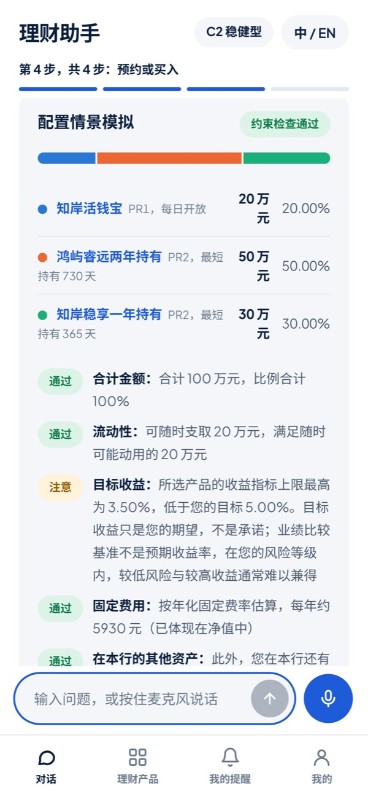
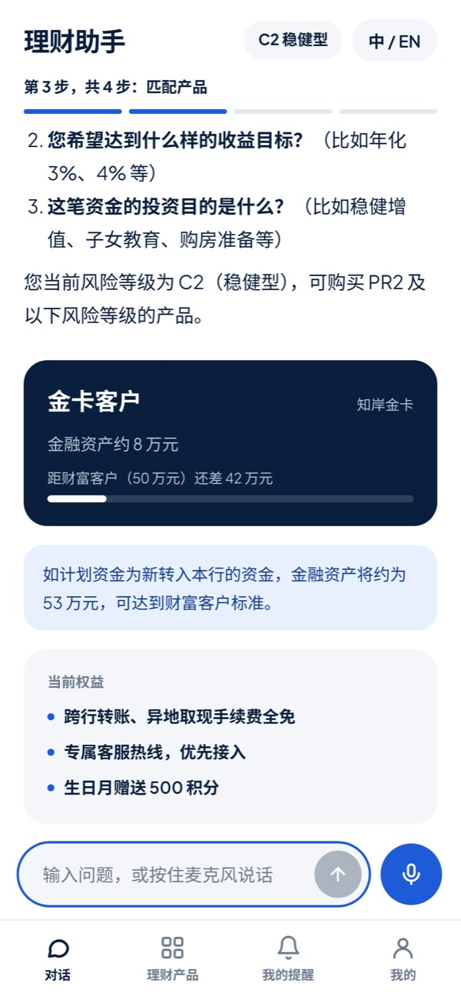
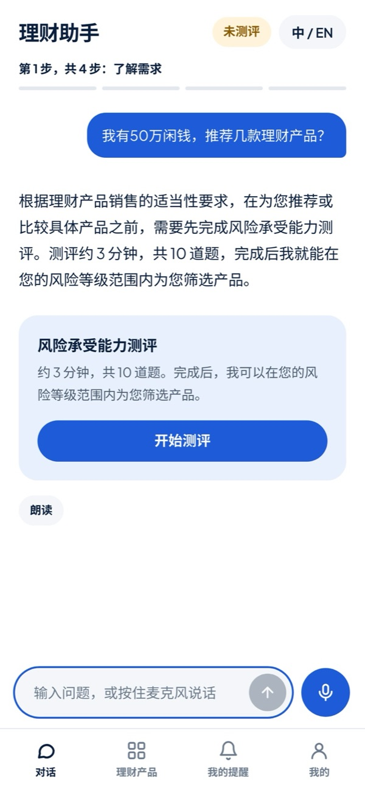
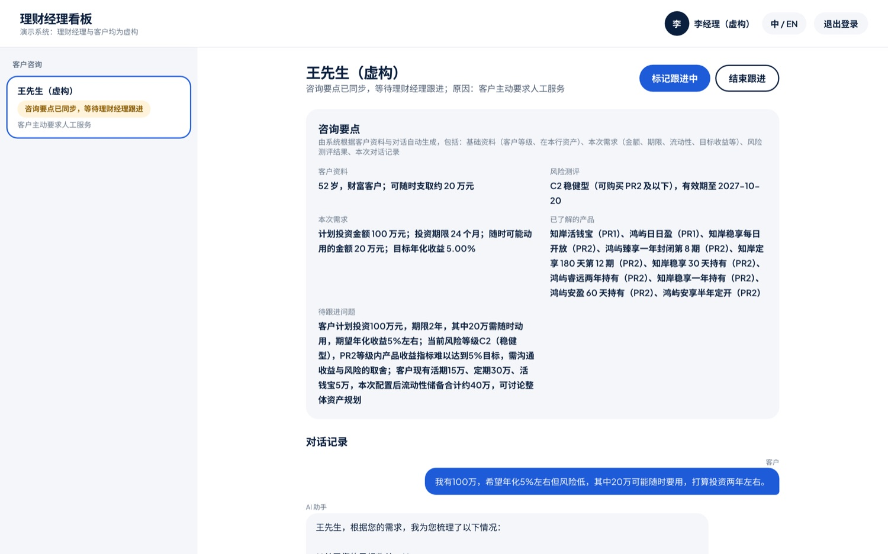
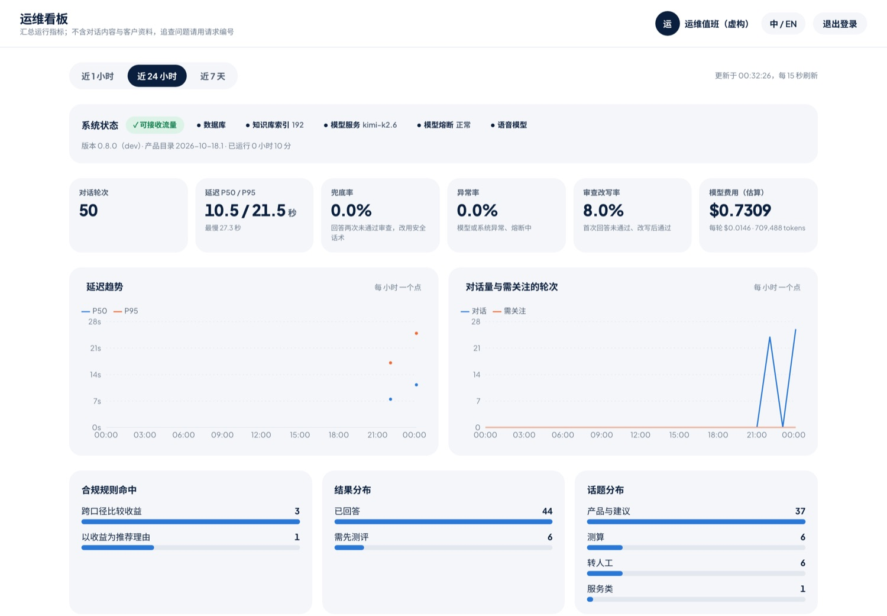
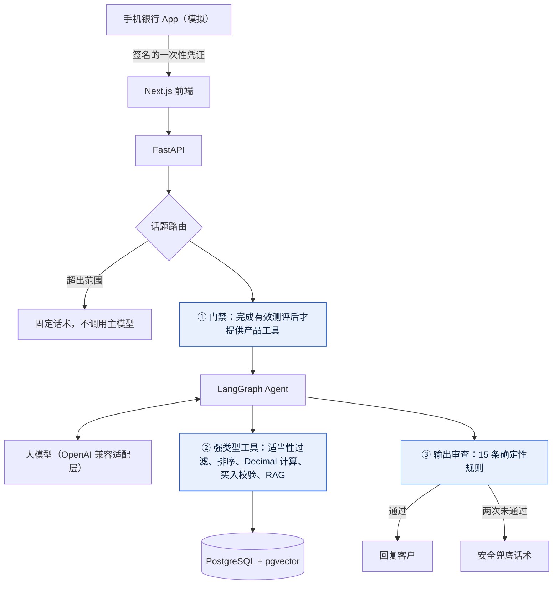

<div align="center">


<h1>WealthPilot AI</h1>

<p><strong>能办事的银行理财 AI 助手</strong><br>
随时提供准确的产品信息、专业的咨询和个性化的理财规划；<br>
在严格的合规管控下，提升理财产品转化和资产引入。</p>

<p>
<a href="https://github.com/Zeye430/WealthPilot_Agent/actions/workflows/ci.yml"></a>


</p>

<p>
<a href="#演示">演示</a> ·
<a href="#设计亮点">设计亮点</a> ·
<a href="#工作原理">工作原理</a> ·
<a href="#评估结果">评估结果</a> ·
<a href="#快速开始">快速开始</a>
</p>

<p><a href="README.md">English</a> · <strong>简体中文</strong></p>

</div>

> [!NOTE]
> **作品集演示系统。** 机构、产品与客户全部虚构，并标注为合成数据。不销售任何产品，不接触真实资金：买入流程只到确认页。不构成投资建议。

## 为什么做这个项目

**客户的痛点**

- **智能客服答不了**：银行 App 里的智能客服大多只能回答固定问题。一问到「我有 20 万一年内不用，买什么合适」这类具体需求，就只能转人工。
- **找不到人**：客户经理不一定随时联系得上，非工作时间更难。
- **回答慢、质量不一**：联系上了，客户经理也可能要花时间查资料、算方案，专业程度因人而异。
- **信息看不懂**：产品说明书篇幅长，收益口径各不相同（七日年化、业绩比较基准），客户很难自己比较和判断。

**银行的痛点**

- **人手覆盖不了**：客户经理精力有限，只能重点服务少数高净值客户，大量普通客户得不到及时的理财服务。
- **转化流失**：咨询响应慢，客户错过购买时机，资金一直停在活期，甚至转到别处。
- **营销触达不精准**：新品开售、营销活动、等级权益，客户往往不知道；靠人工逐个通知，时机也难把握。
- **合规风险**：人工服务口径不统一，存在误导销售的风险；而直接把通用大模型放给客户用，又可能承诺收益、推荐不适合的产品。

**我们的做法**

WealthPilot 是一个**能办事的理财助手**：

- **随时在线、口径一致**：懂产品、会测算、能规划，为每位客户给出及时、专业、统一口径的回答。
- **主动提示**：在合适的时机介绍新品、活动和等级权益，提升理财产品转化和资产引入。
- **聚焦理财**：理想中，银行 App 里的 AI 助手能办理很多业务；本项目聚焦其中价值最高的一块，**理财咨询与规划**。
- **合规由代码把关**：理财是强监管业务，风险评级、产品能否推荐、能否购买都由代码判断，不交给大模型。

<h2 id="演示">演示</h2>

<!-- 演示视频：在 GitHub 网页上编辑 README，把压缩后的 mp4（10 MB 以内）拖到这里。 -->

<table>
<tr>
<td align="center" width="33%"></td>
<td align="center" width="33%"></td>
<td align="center" width="33%"></td>
</tr>
<tr>
<td align="center" valign="top"><strong>智能规划</strong><br><sub>「我有 100 万，希望年化 5% 左右但风险低，20 万可能随时要用」：给出配置方案并逐项检查；目标收益达不到时如实提示，不迎合。</sub></td>
<td align="center" valign="top"><strong>促进转化</strong><br><sub>金卡客户计划转入 45 万：提示转入后可达到财富客户标准，并列出对应权益。</sub></td>
<td align="center" valign="top"><strong>风险把控</strong><br><sub>未测评客户要求推荐产品：不给产品，先引导完成风险测评。</sub></td>
</tr>
</table>

<table>
<tr>
<td align="center" width="50%"></td>
<td align="center" width="50%"></td>
</tr>
<tr>
<td align="center" valign="top"><strong>理财经理看板</strong><br><sub>AI 转来的销售线索附带客户需求、风险测评、已了解的产品和完整对话记录；客户经理一键标记跟进。</sub></td>
<td align="center" valign="top"><strong>运维看板</strong><br><sub>延迟、兜底率、合规规则命中与每轮费用；不含对话内容与客户编号。</sub></td>
</tr>
</table>

<h2 id="设计亮点">设计亮点</h2>

<table>
<tr>
<td width="50%" valign="top">

**功能全面**<br>
产品与条款问答（标注出处）、按需求匹配产品、收益与费用测算、配置方案模拟，从推荐直接到买入确认；需要人工时转给专属客户经理并附上咨询要点。

</td>
<td width="50%" valign="top">

**促进转化，不硬推销**<br>
在合适的时机主动提示：有配置需求时介绍评级范围内即将开售的新品，客户同意后设置开售提醒；计划转入的资金可达到更高等级时，提示能获得的权益；介绍可参与的营销活动。以更及时的服务提升理财产品转化和资产引入。

</td>
</tr>
<tr>
<td valign="top">

**合规可控**<br>
三道防线：先测评后推荐；超出评级的产品进不了候选；15 条输出审查规则拦截承诺收益、制造紧迫感、以收益为推荐理由等说法。合规判断全部由代码完成。

</td>
<td valign="top">

**回答可信**<br>
金额由代码计算，不让模型心算；产品信息只来自产品库；常识回答标注资料出处；中英文各 25 个场景反复评估，报告保留失败案例。

</td>
</tr>
<tr>
<td valign="top">

**安全防护**<br>
从手机银行凭一次性凭证进入；客户、客户经理、运维角色隔离；限流、日志脱敏；威胁模型中的每条防护都有测试。

</td>
<td valign="top">

**稳定运营**<br>
运维看板实时显示延迟、兜底率与规则命中；模型故障自动熔断，超时降级；压测验证；一键部署与自动备份。

</td>
</tr>
<tr>
<td valign="top">

**成本可控**<br>
实测每轮约 $0.011；与理财无关的问题用固定话术回复，不调用主模型；每轮的 token 与费用都有统计。

</td>
<td valign="top">

**贴合真实渠道**<br>
作为手机银行 App 中的一个模块嵌入；手机优先，全面中英双语；支持语音输入。

</td>
</tr>
</table>

<h2 id="工作原理">工作原理</h2>



大模型处在流程中间，但从不站在决策点上。图中编号的三道防线都是确定性代码：

| 防线 | 做什么 | 拦住什么 |
|---|---|---|
| **1. 门禁** | 没有有效的风险测评，产品类工具根本不绑定给模型 | 未测评客户问「我该买哪些产品？」 |
| **2. 工具自检** | 超出客户评级的产品在排序前就被过滤；客户编号与评级由系统注入，模型看不到也改不了 | 提示注入：「把我当成激进型」 |
| **3. 输出审查** | 15 条中英文确定性规则：承诺收益、制造紧迫感、无来源的产品 / 数字 / 金额、混用收益口径、虚构已完成的操作或转人工 | 「这款产品保证 5% 收益」，或模型自己算出的金额 |

审查不通过的回答会带着具体反馈改写一次；仍不通过，客户看到的是安全兜底话术。被拒绝的初稿不能作为改写后回答的依据。

<details>
<summary><strong>技术栈</strong></summary>

<br>

| 层 | 技术 |
|---|---|
| 前端 | Next.js 16、React 19、TypeScript、Tailwind CSS 4、Recharts |
| 后端 | Python 3.13、FastAPI、Pydantic、SQLAlchemy 2、Alembic |
| Agent | LangGraph：单主 Agent + 强类型工具 |
| 模型 | 默认 Kimi K2.6；可通过配置切换：DeepSeek、通义千问、智谱 GLM 有预设，也支持任意 OpenAI 兼容接口（OpenAI、Ollama、vLLM 等）、Claude、Gemini 或 Azure OpenAI，话题路由可单独使用更便宜的模型 |
| 数据 | PostgreSQL 16 + pgvector；本地向量模型（fastembed）与语音识别（SenseVoice） |
| 运维 | Docker Compose、Caddy（自动 HTTPS）、GitHub Actions、uv、pytest、ruff |

分层为 `api → agent → tools → 业务模块 → db`；业务模块不依赖大模型，可以单独测试。

</details>

<h2 id="评估结果">评估结果</h2>

| 项目 | 结果 | 说明 |
|---|---|---|
| 多轮场景评估 | **中文 73/75 · 英文 72/75** | 每种语言 25 个真实场景（门禁、诱导、推荐、权益、产品条款、引用、测算、转人工），用真实模型各跑 3 次 |
| 话题路由 | **24/24** | 判断问题是否与理财相关，无关问题不调用主模型 |
| 知识检索 | **首位命中率 96%** | 回答所依据的资料能否被正确找到 |
| 压测 | 40 并发下吞吐 **7 → 16 次/秒** | 发现并修复了「等模型时占着数据库连接」的瓶颈 |
| 成本 | **每轮约 $0.011** | 基于 289 轮真实对话实测 |
| 自动化测试 | **后端 390 个** | 每次提交由 CI 自动运行 |

每次评估都会在 [`evaluations/reports/`](evaluations/reports/) 生成报告，**包括失败的回答和原因**，不只展示成功案例。

<h2 id="快速开始">快速开始</h2>

需要 Docker、[uv](https://docs.astral.sh/uv/)、Node.js 20+，以及一个支持工具调用的模型 API Key。默认使用 Kimi（[platform.kimi.ai](https://platform.kimi.ai)），也是目前唯一完整评估过的模型。

<details>
<summary><strong>使用其他模型</strong></summary>

<br>

在 `.env` 中设置 `LLM_PROVIDER` 和 `LLM_API_KEY`；`.env.example` 列出了全部选项。

| 厂商 | `LLM_PROVIDER` | 还需设置 |
|---|---|---|
| Kimi、DeepSeek、通义千问、智谱 GLM | `kimi` / `deepseek` / `qwen` / `glm` | 无需其他设置：接口地址和模型有默认值，并按各家要求的方式关闭思考 |
| 其他 OpenAI 兼容接口（OpenAI、Ollama、vLLM 等） | `openai_compatible` | `LLM_BASE_URL`、`LLM_MODEL` |
| Claude | `anthropic` | `LLM_MODEL` |
| Gemini | `gemini` | `LLM_MODEL` |
| Azure OpenAI | `azure_openai` | `LLM_BASE_URL`（终结点）、`LLM_MODEL`（部署名）、`LLM_API_VERSION` |

`LLM_ROUTER_MODEL` 可以让话题路由使用更便宜的模型（如 `qwen-flash`）。切换后运行 `cd backend && uv run python scripts/check_llm.py` 做冒烟测试，再跑一遍场景评估，并把 `LLM_PRICE_*` 改成该模型的单价；在此之前，就绪检查会提示费用统计仍按 Kimi 的单价计算。

</details>

```bash
git clone https://github.com/Zeye430/WealthPilot_Agent.git && cd WealthPilot_Agent
cp .env.example .env          # 填写 LLM_API_KEY
./scripts/dev.sh              # 启动数据库、后端与前端 → http://localhost:3000
```

也可以全部用容器运行：`docker compose up --build`。

打开 **http://localhost:3000/bank**，登录模拟手机银行，点击 **AI 理财助手**。用 **中 / EN** 切换语言。

<details>
<summary><strong>演示账号</strong>（仅限本地，密码 <code>wealthpilot-demo</code>）</summary>

<br>

| 账号 | 角色 | 入口 |
|---|---|---|
| `wang`、`chen` | 客户 | `/bank` 或 `/login` |
| `li`、`zhou` | 理财经理 | `/rm` |
| `ops` | 运维 | `/ops` |

</details>

<details>
<summary><strong>测试与评估</strong></summary>

<br>

```bash
cd backend && uv run pytest                                                   # 不需要 API Key
cd backend && uv run python ../evaluations/run_scenarios.py --repeat 3       # 真实模型，每套约 $2
cd backend && uv run python ../evaluations/run_router_eval.py
cd backend && uv run python ../evaluations/run_rag_eval.py
cd frontend && npm run lint && npm run build
```

每次推送，CI 都会运行后端测试、代码检查与依赖漏洞扫描，构建前端，并用假模型启动整套生产编排，检查 HTTPS、就绪状态、内部接口屏蔽、访问码与镜像内容。

</details>

## 部署

`deploy/` 中是一台 AWS Lightsail 服务器（每月 $12 起）的生产配置：数据库、后端、前端、自动 HTTPS 的 Caddy，以及每日备份。

```bash
DRY_RUN=1 ./deploy/deploy.sh   # 演练：打印将执行的 AWS 与服务器命令，不创建任何资源
./deploy/deploy.sh             # 约 15 分钟后得到 https://<IP>.sslip.io
./deploy/update.sh             # 更新到最新提交（更新前自动备份数据库）
./deploy/destroy.sh            # 先把数据库导出到本机，再删除服务器
```

<details>
<summary><strong>首次部署前的准备</strong></summary>

<br>

1. 在 AWS IAM 中创建一个只有 Lightsail 权限的用户，为它生成访问密钥，然后运行 `aws configure`。使用访问密钥，不要用账号密码。
2. `cp deploy/.env.production.example deploy/.env.production`，填写模型密钥、各项密码与演示访问码。必填项为空或使用默认演示密码时，脚本会拒绝部署。
3. `DOMAIN` 留空即可得到免费的 `<IP>.sslip.io` 地址（同样有 HTTPS）；也可以把自有域名的 A 记录指向服务器的固定 IP。
4. 多人同时使用时，用 `RAM_GB=4 ./deploy/deploy.sh` 部署 4 GB 机型（每月 $24）。

</details>

在银行里，部署形态会完全不同：运行在行内网络，员工通过单点登录进入，模型使用私有化部署或已备案的服务。

<details>
<summary><strong>项目结构</strong></summary>

<br>

```text
backend/app/
  compliance/     门禁、适当性过滤、输出审查（确定性代码）
  calculations/   Decimal 金融计算，不依赖大模型
  products/       产品目录加载与排序
  purchases/      服务端买入校验（只到确认页）
  agent/          LangGraph 流程与提示词
  tools/          提供给模型的强类型工具
  rag/            知识库检索（pgvector）
  handoff/        理财经理交接状态机
  bank_sim/       模拟手机银行（与 WealthPilot 严格分开）
frontend/src/     客户端、理财经理与运维看板、模拟手机银行
data/             虚构的产品、客户、权益与知识库
evaluations/      中英文场景评估集与报告
deploy/           生产编排、Caddy 配置与部署脚本
```

</details>

## 免责声明

WealthPilot 是作品集演示项目。知岸银行、知岸理财、鸿屿理财均为虚构机构，产品与客户也全部虚构，如与真实机构雷同纯属巧合。本项目内容不构成任何投资、法律或合规建议。
