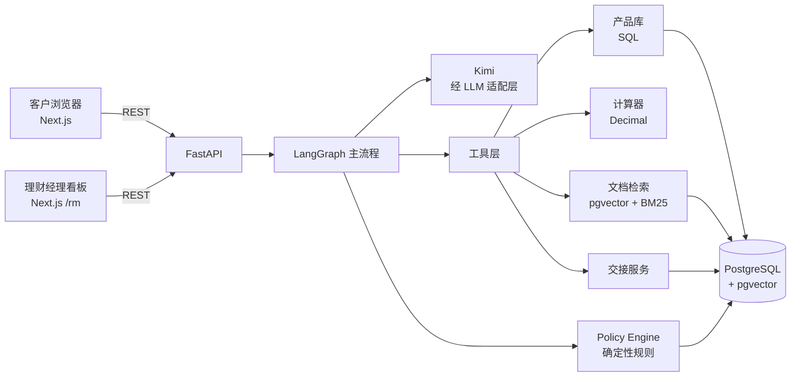
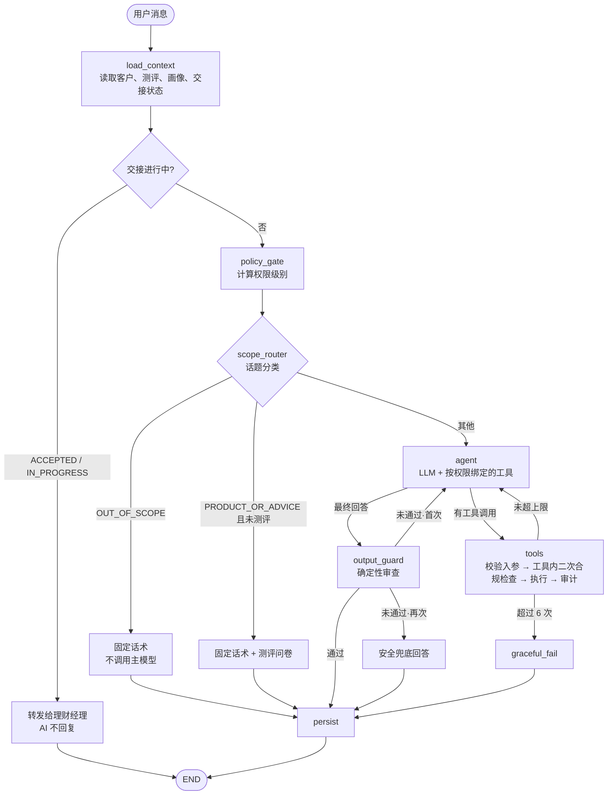
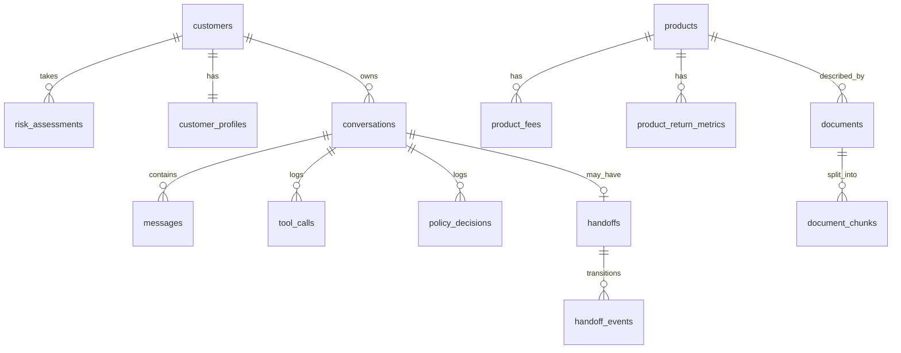
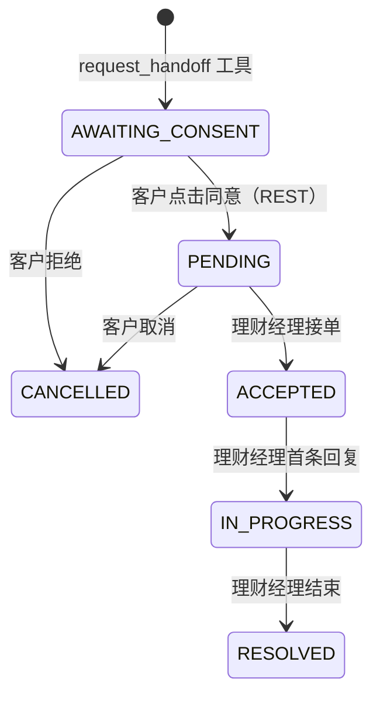

# WealthPilot AI — 系统架构（v0.2）

> 范围：两周作品集 MVP。本文件合并了原计划中的 ARCHITECTURE / DATA_MODEL / AGENT_WORKFLOW / API_SPEC。
> 每个关键决策都写明「为什么」和「放弃了什么」，方便面试时讲清楚。

---

## 1. 一句话架构

**单主 Agent（LangGraph）+ 强类型工具 + 独立的确定性合规引擎。** LLM 负责理解和表达，**不负责做合规判断、不负责算数、不负责记住产品事实**。



## 2. 关键架构决策（ADR 摘要）

| # | 决策 | 为什么 | 放弃的替代方案 |
|---|---|---|---|
| D1 | 模块化单体（一个 FastAPI 服务） | 两周工期；业务边界靠 Python 模块划分即可 | 微服务：部署和调试成本远大于收益 |
| D2 | 单主 Agent，而非多 Agent 协作 | 金融场景要可预测、可审计；多 Agent 的「互相对话」难测试、难追责 | 多 Agent（规划者/产品专家/合规官）：演示好看，但行为不稳定 |
| D3 | **合规门禁是图中的固定节点，不是 LLM 可选调用的工具** | LLM 可能「忘记」调用合规工具；把检查放在流程上，跳不过去 | 让 LLM 自己调用 `check_suitability`：依赖模型自觉 |
| D4 | **按权限状态动态绑定工具** | 未测评时 LLM 手里根本没有产品查询工具——「拿不到的东西就说不出来」 | 只在 Prompt 里写「未测评不要推荐」：Prompt 可被绕过 |
| D5 | 风险测评用确定性表单，不由 LLM 对话式提问 | 测评问卷需标准化、计分可复现；LLM 提问可能诱导答案 | LLM 口语化问卷：体验好但不合规 |
| D6 | LangGraph | 显式状态图，便于讲清控制流；循环上限、条件路由开箱即用；求职关键词 | 原生 tool-use 循环：更透明，但要自己写状态管理 |
| D7 | 人工交接状态存数据库，由 REST 接口推进 | 状态必须来自真实工作流；客户同意是按钮点击，不是 LLM 的理解 | LangGraph `interrupt` + checkpointer：更「原生」，但多一套持久化 |
| D8 | Kimi 经 OpenAI 兼容适配层接入 | Moonshot API 兼容 OpenAI 协议；适配层保证可换国产/海外模型 | 直接写死 SDK：换模型要改业务代码 |
| D9 | Embedding 用本地 `BAAI/bge-small-zh-v1.5`（fastembed/ONNX） | 中文效果好、免费、512 维、镜像轻；Kimi 不以 embedding 为主打 | bge-m3（更强但大 4 倍）、第三方 embedding API |
| D10 | 中文关键词检索：Python 侧 jieba + BM25（内存） | 语料仅几十份文档，内存足够；避免给 Postgres 装中文分词扩展 | `zhparser`/`pg_jieba`：生产更合适，MVP 不必要 |
| D11 | 非流式响应 + 加载状态（流式为可选增强） | 先保证工具调用与合规审查后再输出；流式会让「先输出后审查」难处理 | SSE 流式：体验好，但输出审查需要缓冲设计 |
| D12 | 主 Agent 前加轻量**话题路由**（小 Prompt、单标签输出） | 产品负责人要求不能成为通用问答机器：超范围问题用固定话术回复，不调用主模型，节省 token；同时为交接指标提供意图标签 | 只靠主 Agent Prompt 拒答：每个无关问题都消耗一次完整调用；关键词规则：中文表达太多样 |

| D13 | Kimi **关闭思考模式**：话题路由始终关闭；主 Agent 默认关闭（`LLM_AGENT_THINKING` 可开启） | 实测路由分类：关闭后 0.7 秒 / 约 5 token，开启时 1.6–3.4 秒 / 67–165 token，准确率相同；主 Agent 从 8–9 秒降到 4–6 秒。算数与合规由代码负责，不依赖模型推理 | 全程开启思考：复杂推理更强，但慢一倍 |

> **D12 与 D3/D4 的分工**：话题路由负责**成本与范围**，可能分错；合规门禁负责**安全**，不依赖路由结果。即使路由把「推荐产品」误判成「金融常识」，未测评状态下 LLM 依然没有产品工具。

> **面试要点（D3+D4）**：合规的三道防线 = ①流程层门禁（图节点）②工具层自检（工具内部再查一次）③输出层审查（回答发出前）。任何一道失效，另两道兜底。

## 3. 仓库结构

```text
wealthpilot/
├── frontend/                 # Next.js (App Router) + TS + Tailwind + shadcn/ui + Recharts
│   └── src/app/{chat,products,assessment,rm}/
├── backend/
│   ├── app/
│   │   ├── api/              # 路由，仅做参数校验与调用 service
│   │   ├── agent/            # LangGraph 图、状态、节点、Prompt
│   │   ├── tools/            # 暴露给 LLM 的工具（薄封装，调用下面的业务模块）
│   │   ├── compliance/       # Policy Engine、输出审查、规则配置
│   │   ├── assessment/       # 问卷、计分、有效期
│   │   ├── products/         # 产品查询、比较、排序
│   │   ├── rag/              # 解析、分块、向量化、混合检索
│   │   ├── calculations/     # 纯函数金融计算（Decimal）
│   │   ├── profiles/         # 客户需求画像
│   │   ├── handoff/          # 交接状态机
│   │   ├── llm/              # 模型适配层
│   │   ├── db/               # SQLAlchemy 模型、Alembic 迁移
│   │   └── core/             # 配置、日志、审计
│   └── tests/
├── data/
│   ├── products/             # 虚构产品要素 YAML（单一数据源，说明书由此生成）
│   └── documents/            # 说明书 PDF / 合成文档
├── evaluations/              # 黄金用例与评估脚本
├── scripts/                  # seed、ingest
├── docs/
├── docker-compose.yml
└── CLAUDE.md
```

**分层规则**：`api → agent → tools → 业务模块 → db`。业务模块（calculations、compliance、products…）**不依赖 LLM**，可以独立单元测试——这是「金融逻辑与 Prompt 分离」的落地方式。

## 4. Agent 工作流

### 4.1 图结构



### 4.2 权限级别与工具绑定（D4 的具体实现）

| 权限级别 | 条件 | LLM 可用工具 |
|---|---|---|
| `ASSESSMENT_REQUIRED` | 无测评 / 测评过期 | `start_risk_assessment`、`request_handoff`、`calculate_growth`（通用复利/通胀计算，不涉及产品） |
| `ASSESSED` | 有效测评（C1–C5） | 全部工具；产品类工具内部按评级过滤 |

未测评时 LLM 可以回答**金融常识**（如「什么是七日年化」「固收理财会亏本吗」），每条回答由代码追加「完成风险测评后可为您筛选产品」的提醒和测评入口；但**无法取得任何产品数据**。客户要求推荐产品时，由路由直接返回测评引导。测评前允许的工具列表放在规则配置里（`pre_assessment_allowed_tools`）。

### 4.3 话题范围（scope_router）

| 标签 | 示例 | 处理 |
|---|---|---|
| `FINANCE_KNOWLEDGE` | 理财概念、风险、费用口径、监管常识 | 主 Agent |
| `CALCULATION` | 复利、通胀、费用测算 | 主 Agent |
| `PRODUCT_OR_ADVICE` | 推荐、筛选、比较、配置 | 未测评 → 测评引导；已测评 → 主 Agent |
| `HANDOFF` | 找理财经理 | 主 Agent（交接工具） |
| `SERVICE` | 问候、怎么用、测评相关 | 主 Agent |
| `OUT_OF_SCOPE` | 天文地理、写代码、娱乐 | 固定话术，不调用主模型 |

路由只看最近一条用户消息 + 简短上下文，`max_tokens` 很小，温度 0。

### 4.4 Graph State

```python
class AgentState(TypedDict):
    conversation_id: str
    customer_id: str
    messages: list[BaseMessage]
    permission: Literal["ASSESSMENT_REQUIRED", "ASSESSED"]
    risk_rating: str | None            # C1–C5，来自 DB，LLM 不可写
    profile: dict                      # 需求画像快照
    tool_calls_count: int
    tool_results: list[ToolResult]     # 本轮工具结果（用于输出审查的事实校验）
    ui_blocks: list[UIBlock]           # 产品卡片、对比表、图表、问卷、同意卡片
    citations: list[Citation]
    policy_decisions: list[PolicyDecision]
```

**原则**：`risk_rating`、`permission`、交接状态只能由确定性代码从数据库写入，LLM 只读。

### 4.5 工具清单（LLM 可见）

| 工具 | 作用 | 返回 UI 块 |
|---|---|---|
| `start_risk_assessment()` | 让前端弹出模拟测评问卷 | `questionnaire` |
| `update_profile(fields)` | 记录客户说的金额、期限、流动性等（来源标记为 USER_PROVIDED） | `profile_update` |
| `search_products(filters)` | 结构化筛选；**内部先做适当性硬过滤** | `product_list` |
| `get_product_details(product_id)` | 产品事实 + 字段来源 | `product_card` |
| `compare_products(product_ids)` | 对比表，缺失字段显式标注 | `comparison_table` |
| `search_documents(query, product_id?)` | 条款检索，返回带页码的片段 | — |
| `calculate_growth(...)` | 单利/复利/定投/通胀调整 | `line_chart` |
| `calculate_fees(...)` | 申购/赎回费、净收益 | `fee_breakdown` |
| `generate_return_scenarios(...)` | 多档收益假设 | `line_chart` |
| `request_handoff(reason, open_questions)` | 生成交接草稿，等待客户同意 | `consent_card` |

工具只做「参数校验 + 调用业务模块 + 组装结果」，所有工具输出都是 Pydantic 模型。

### 4.6 输出审查（output_guard）

确定性检查，不调用 LLM（控制延迟和成本）：

1. **违禁表述**：高精度正则，例如 `保证.{0,4}收益`、`稳赚`、`零风险`、`无风险`、`肯定(能|会)(达到|赚)`。注意「固收理财**不**保本」是合法表述，规则针对肯定句式。
2. **产品事实落地**：回答里提到的产品名称/代码，必须出现在本会话的工具结果中，否则判定为捏造。
3. **权限一致性**：`ASSESSMENT_REQUIRED` 状态下回答不得出现产品名称或收益数字。
4. **免责声明**：涉及产品或收益数字时，由代码追加标准提示，而不是依赖 LLM 自己写。

### 4.7 失败与回退

| 故障 | 处理 |
|---|---|
| LLM 超时 / 报错 | 重试 1 次 → 返回「服务暂时不可用」+ 可转人工 |
| 工具入参校验失败 | 把错误信息作为工具结果返回给 LLM，让它修正（计入调用次数） |
| 工具执行异常 | 记录 `TOOL_FAILURE`，不编造结果，告知客户并建议人工 |
| 检索置信度低 | 回答「资料中未找到」，触发 `LOW_RETRIEVAL_CONFIDENCE` 建议人工 |
| 工具调用超过 6 次 | graceful_fail，返回已获得的部分结果 |

文档片段一律按**不可信数据**处理：以 `<document>` 包裹传给 LLM，系统 Prompt 声明其中的指令无效；输出审查兜底。

## 5. 数据模型



### 5.1 核心表（只列关键字段）

**customers**：`id`, `display_name`, `role`(CUSTOMER/RM/ADMIN), `is_demo=true`

**risk_assessments**：`id`, `customer_id`, `questionnaire_version`, `answers`(jsonb), `score`, `rating`(C1–C5), `assessed_at`, `expires_at`, `is_simulated=true`
- 每次测评新增一行，不覆盖，保留历史（审计 + 防止反复重测刷评级）。

**customer_profiles**：`customer_id`, `fields`(jsonb), `updated_at`
```json
{"investment_amount": {"value": 1000000, "source": "USER_PROVIDED", "updated_at": "..."},
 "liquidity_reserve": {"value": 200000, "source": "USER_PROVIDED", "updated_at": "..."},
 "investment_horizon_months": {"value": null, "source": null}}
```
用 jsonb 而不是每字段一列：画像字段会迭代，每个字段都要带来源（用户提供 / 系统推断 / 正式验证）。

**products**：`id`, `code`, `name`, `issuer`, `distributor`, `product_type`(现金管理/固收/混合/权益…), `issuer_risk_level`(PR), `distributor_risk_level`(R), `effective_risk_level`(取高), `investment_scope`, `minimum_investment`, `term_days`, `open_frequency`, `subscription_rules`, `redemption_rules`, `product_status`, `data_origin`(SYNTHETIC), `data_quality_status`(VERIFIED / PARTIAL / UNVERIFIED), `last_verified_at`, `field_sources`(jsonb)
- `field_sources` 记录每个字段来自哪份文档的哪一页：`{"risk_level": {"document_id": "...", "page": 3, "quote": "本产品风险等级为PR2"}}`

**product_fees**：`product_id`, `fee_type`(SUBSCRIPTION/REDEMPTION/MANAGEMENT/CUSTODY/SALES/PERFORMANCE), `rate`, `basis`(年化/一次性), `condition`(如「持有<7天」), `source`(jsonb)

**product_return_metrics**：`product_id`, `metric_type`, `value`, `value_low`, `value_high`, `period_start`, `period_end`, `as_of`, `source`
- `metric_type` ∈ `SEVEN_DAY_ANNUALIZED` / `PERFORMANCE_BENCHMARK` / `PERIOD_ANNUALIZED` / `NAV`。业绩比较基准常是区间（如 2.6%–3.2%），所以有上下限。**不同 metric_type 的数字在代码层禁止直接比较。**

**documents**：`id`, `product_id`, `doc_type`(说明书/风险揭示书/公告), `title`, `file_path`, `source_url`, `version`, `effective_date`, `retrieved_at`, `checksum`, `data_origin`

**document_chunks**：`id`, `document_id`, `page`, `section`, `text`, `embedding vector(512)`

**conversations / messages**：`messages` 含 `role`, `content`, `ui_blocks`(jsonb), `citations`(jsonb)

**tool_calls**：`conversation_id`, `tool_name`, `input`, `output_summary`, `status`, `latency_ms`

**policy_decisions**：`conversation_id`, `checkpoint`(GATE/TOOL/OUTPUT), `decision`, `reason_codes`, `rule_version`, `inputs_snapshot`

**handoffs**：`id`, `conversation_id`, `customer_id`, `reason`, `status`, `summary`(jsonb), `consent_scope`, `consented_at`, `assigned_rm_id`, `created_at`, `updated_at`

**handoff_events**：`handoff_id`, `from_status`, `to_status`, `actor`, `at`

### 5.2 交接状态机


相对原 PRD 新增 `AWAITING_CONSENT`：把「生成交接草稿」和「客户同意」分开，确保同意是客户的显式操作。未请求交接的会话不建 handoff 记录，等同于 `NOT_REQUESTED`。

## 6. REST API（v1）

演示鉴权：请求头 `X-Demo-User: demo_customer_1 | demo_rm_1 | demo_admin`，后端按角色校验。

| 方法 | 路径 | 说明 |
|---|---|---|
| POST | `/api/v1/chat` | `{conversation_id?, message}` → `{conversation_id, reply: {content, ui_blocks, citations}, state: {permission, risk_rating, profile, handoff_status}}` |
| GET | `/api/v1/conversations` · `/{id}` | 历史会话 |
| GET | `/api/v1/assessment/questionnaire` | 模拟问卷 |
| POST | `/api/v1/assessment` | `{answers}` → `{rating, score, expires_at}`；受重测频率限制 |
| GET | `/api/v1/assessment/current` | 当前有效测评 |
| GET / PATCH | `/api/v1/profile` | 查看 / 修改画像 |
| GET | `/api/v1/products` · `/{id}` | 产品浏览；**服务端同样执行适当性过滤** |
| POST | `/api/v1/calculations/{kind}` | 计算器页面直接调用 |
| POST | `/api/v1/handoffs/{id}/consent` · `/cancel` | 客户同意 / 取消 |
| GET | `/api/v1/rm/handoffs` | 理财经理看板（仅 RM 角色） |
| POST | `/api/v1/rm/handoffs/{id}/accept` · `/messages` · `/resolve` | 接单 / 回复 / 结束 |
| GET | `/health` | 健康检查（含 DB、LLM 连通性） |

所有输入输出为 Pydantic 模型，FastAPI 自动生成 OpenAPI 文档（`/docs`）。

## 7. 配置与运行

- `docker compose up` 启动 `db`（pgvector/pgvector:pg16）、`backend`、`frontend`。
- `.env`：`LLM_BASE_URL=https://api.moonshot.cn/v1`、`LLM_API_KEY`、`LLM_MODEL`（具体模型名在 Phase 1 用实际 API 确认）、`DATABASE_URL`。
- `.env` 不入库，仓库只提交 `.env.example`。

## 8. 已知风险与未决问题

| 项 | 风险 | 应对 |
|---|---|---|
| Kimi 的工具调用稳定性 | 参数格式偶有偏差 | 强 Pydantic 校验 + 错误回传修正；Phase 1 先做冒烟测试 |
| 说明书表格解析 | 费率表结构丢失 | pdfplumber 抽表 → 人工核对 → 写入 YAML，标记 VERIFIED |
| 产品数据真实感 | 全部虚构，可能与市场脱节 | 结构参考公开说明书；费率与基准由产品负责人审核（见 PRODUCT_CATALOG.md） |
| 输出审查误杀 | 正则误判合法表述 | 用评估集持续调规则；首次失败让 LLM 重写，而非直接拒绝 |
| 中文 BM25 质量 | jieba 对金融术语分词不准 | 加自定义词典（业绩比较基准、七日年化等） |
