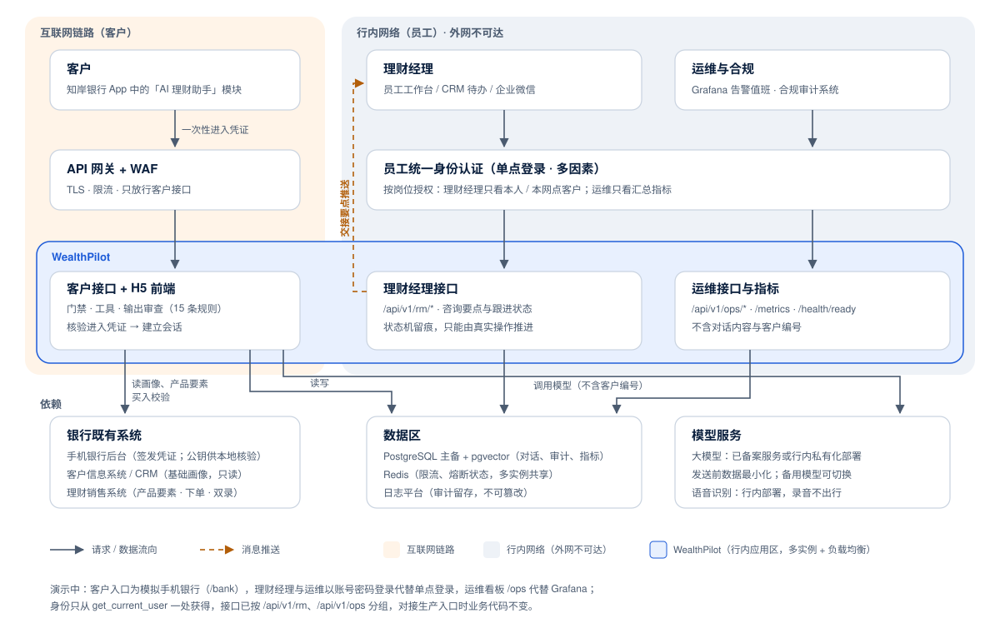

# WealthPilot AI — 生产落地：部署架构与差距清单（v0.1）

> 本文回答「这个系统如果在一家银行真正上线，长什么样、还差什么」。
> 演示系统按真实金融应用的思路设计，但有意简化了部分环节；这里逐项说明简化了什么、生产中怎么做、优先级如何。
> 涉及监管的条目只是工程视角的整理，**上线前须经持牌机构合规与法务确认**。美国监管对照见 [US_REGULATORY_MAPPING.md](US_REGULATORY_MAPPING.md)。

## 1. 生产部署架构

三类用户从三个不同的入口进入，经过不同的网络区域，身份由不同的系统核验。

图中三列从左到右：客户（互联网链路）、理财经理与运维合规（行内网络）；从上到下：入口 → 网络接入 → WealthPilot → 依赖的银行系统、数据区与模型服务。

要点：

- **只有客户接口暴露在互联网上**：理财经理接口、运维接口、`/metrics` 只在行内网络开放，网关不转发这些路径。演示中这些接口已经按前缀分组（`/api/v1/rm/`、`/api/v1/ops/`），部署时按路径分流即可，代码无需改动。
- **WealthPilot 不保存银行的核心数据**：基础画像、产品要素、交易都从行内既有系统读取，WealthPilot 只保存对话、本次需求、测评记录、审计与运行指标。
- **大模型的位置是关键决策**：使用外部模型服务时，客户信息出境 / 出行的合规要求很高；国内银行更常见的做法是行内私有化部署或使用已完成备案的模型服务，并在发送前做数据最小化（演示中模型已看不到客户身份证件等信息，客户编号也通过注入状态传递，不进入提示词）。

## 2. 三个入口与身份对接

| | 客户 | 理财经理 | 运维 / 合规 |
|---|---|---|---|
| 入口 | 手机银行 App 的「AI 理财助手」模块（H5 嵌入 WebView） | 员工工作台 / CRM 的待办，或企业微信消息 | Grafana 等监控平台；合规审计系统 |
| 身份核验 | App 签发的一次性凭证（银行私钥签名，WealthPilot 公钥核验） | 员工统一身份认证（OIDC / SAML 单点登录） | 同左，按岗位授权 |
| 网络 | 互联网 → 网关 / WAF | 仅行内网络 | 仅行内网络 |
| 数据范围 | 本人数据 | 按机构层级：本人或本网点分配的客户 | 运维只看汇总指标；合规按授权调阅对话 |
| **演示中的实现** | `/bank` 模拟手机银行 → 签名凭证 → 免密进入（[D49–D51](ARCHITECTURE.md)），代码与测试都已具备 | 账号密码登录 `/rm`（代替单点登录） | 账号密码登录 `/ops`（代替 Grafana） |
| **改造量** | 换成银行的公钥与凭证格式（RS256 JWT），关闭模拟银行 | 替换 `get_current_user` 为单点登录核验；交接推送改为调用 CRM / 企业微信接口 | 接入 Prometheus 抓取 `/metrics`，按 [ARCHITECTURE §4.8](ARCHITECTURE.md) 的阈值配置告警 |

身份只从一个函数（`get_current_user`）获得，三种入口的对接都只改这一处，业务代码不动。

## 3. 演示与生产的差距清单

优先级：**P0** 上线前必须完成；**P1** 上线初期完成；**P2** 规模化后完成。

### 3.1 身份、接入与系统集成

| 项目 | 演示现状 | 生产需要 | 优先级 |
|---|---|---|---|
| 客户身份 | 模拟手机银行 + HMAC 签名凭证 | 银行私钥签名（RS256 / ES256），WealthPilot 只持公钥；凭证经 JS 桥或 POST 传递，不放在地址里 | P0 |
| 员工身份 | 演示账号密码 | 统一身份认证 + 多因素认证；离职调岗即时失效 | P0 |
| 客户基础画像 | YAML 模拟银行系统（只读适配层已就位） | 对接 CRM / 客户信息系统接口；接口超时与降级 | P0 |
| 产品要素 | YAML 维护的虚构产品 | 对接理财销售系统，产品上下架、费率变更实时同步；要素变更留痕 | P0 |
| 买入 | 只到确认页，不下单 | 对接交易系统；风险揭示、冷静期、双录（如适用）由交易系统负责，AI 只引导到交易入口 | P0 |
| 理财经理协同 | 应用内看板 | 交接要点推送到 CRM 待办或企业微信；按机构层级分配 | P1 |

### 3.2 合规

| 项目 | 演示现状 | 生产需要 | 优先级 |
|---|---|---|---|
| 风险测评 | 自行设计的模拟问卷 | 使用银行经监管报备的正式问卷与评级规则；测评结果写回银行系统，与柜面、App 其他渠道一致 | P0 |
| 输出审查规则 | 15 条确定性规则，中英文各 25 个场景评估 | 合规部门逐条审阅并签批；规则变更走审批与版本管理（规则已带版本号）；定期抽检对话 | P0 |
| 话术与宣传 | 固定话术、代码追加的风险提示 | 风险提示与宣传用语经合规审核报备；与产品销售文件一致 | P0 |
| 生成式 AI 监管 | — | 按《生成式人工智能服务管理暂行办法》等规定履行备案 / 登记；明确告知客户在与 AI 交流 | P0 |
| 留痕与保存 | 对话、工具调用、审查决策、交接全程入库 | 按监管要求的期限保存、不可篡改（WORM 存储）；合规审计系统按授权调阅 | P0 |
| 投诉与纠错 | 请求编号可定位整条链路 | 客户投诉处理流程：按编号调阅、复核、整改规则，并纳入消费者权益保护的工作机制 | P1 |

### 3.3 数据与隐私

| 项目 | 演示现状 | 生产需要 | 优先级 |
|---|---|---|---|
| 个人信息 | 虚构客户；日志脱敏；指标不含对话与客户编号 | 按《个人信息保护法》做告知同意（金融账户属敏感个人信息）、最小化、保存期限、删除权响应 | P0 |
| 发送给模型的数据 | 客户编号与评级经注入状态传递，不进入提示词；不含证件号等 | 字段级脱敏清单；外部模型服务需评估数据出境 / 出行；优先行内部署 | P0 |
| 等级保护 | 威胁模型 + 每条防护有测试 | 按网络安全等级保护要求定级测评（金融业务通常三级）；渗透测试 | P0 |
| 外包与第三方 | — | 模型服务商、云服务按信息科技外包管理要求评估 | P1 |

### 3.4 可靠性与可运维

| 项目 | 演示现状 | 生产需要 | 优先级 |
|---|---|---|---|
| 部署形态 | 单进程（P8-6 部署到一台云主机） | 多实例 + 负载均衡；按 CPU 核数开多进程（单进程实测约 18 次/秒，见压测报告） | P0 |
| 共享状态 | 限流、熔断为进程内存 | 迁移到 Redis（接口已保持一致） | P0 |
| 数据库 | 单实例 | 主备 / 高可用；备份与恢复演练；明确 RTO / RPO | P0 |
| 告警 | 阈值已定义，看板高亮 | Prometheus 告警规则 + 值班轮转；故障处理按 [RUNBOOK.md](RUNBOOK.md) | P0 |
| 模型容灾 | 熔断 + 明确提示 | 备用模型（适配层已支持切换），主模型故障时降级；切换前在备用模型上跑场景评估 | P1 |
| 发布 | CI 运行测试 | 灰度发布；规则与提示词变更先在影子流量上跑评估；可快速回滚 | P1 |
| 推荐 → 买入转化漏斗 | 未做（买入不落库） | 增加买入事件，衡量 AI 的业务价值；同时监控是否有不当推荐倾向 | P1 |

### 3.5 模型质量与治理

| 项目 | 演示现状 | 生产需要 | 优先级 |
|---|---|---|---|
| 质量评估 | 每次改动后跑中英文场景评估（每场景 3 次） | 评估集扩充到数百个场景，覆盖真实客户问法；上线后抽样人工复核 | P0 |
| 模型变更 | 配置切换 | 模型或提示词变更视同模型变更：评估达标 + 合规签批后才能上线（模型风险管理） | P0 |
| 知识库维护 | 法规原文自动核对、条目到期停止引用 | 指定维护人与复核周期；法规更新的跟踪流程 | P1 |
| 成本 | 实测每轮约 $0.011（按未命中缓存的价格） | 提示词缓存、上下文精简、按话题选模型，见 [COST_ESTIMATE.md](COST_ESTIMATE.md) | P1 |

## 4. 如果只有一周时间上线试点

在差距清单中选出最小集合：**身份对接（客户凭证 + 员工单点登录）、产品与画像对接、合规签批规则与话术、日志留存、两实例 + Redis + 数据库主备、告警**。其余按 P1 / P2 在试点期间补齐。试点范围建议限定为「已测评客户 + 理财常识与产品咨询」，买入仍走现有交易入口。
