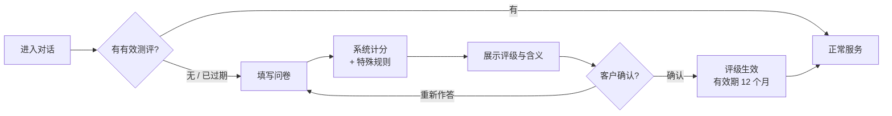

# 模拟风险承受能力测评问卷（v0.1 草案）

> **状态：2026-10-17 产品负责人审核通过**，已实现为 `backend/app/assessment/questionnaire_v1.yaml`。
> 本问卷为作品集演示自行设计，**非任何金融机构的正式问卷**，界面上会明确标注「模拟问卷」。
> 审核通过后转为 `backend/app/assessment/questionnaire_v1.yaml`，由代码读取并计分；本文件保留为设计说明。

---

## 1. 设计依据

国内没有统一的标准问卷，监管规定的是评估维度和结果用途，题目、题数、分值和分档由各机构自行设计。本问卷参考公开资料的**维度与结构**，题目为自行编写：

| 参考资料 | 借鉴的内容 |
|---|---|
| 银行普遍采用的评估维度（年龄、财务状况、投资经验、投资目的、收益预期、风险偏好、流动性要求、风险认识、风险损失承受程度） | 10 道题覆盖这 9 个维度 |
| 华夏银行公开问卷说明（满分 100 分；C1-0 子类：特定题选 A 直接归入） | 百分制；一票否决题 |
| 中国银行《代销理财产品投资者权益须知（2022 年版）》 | 五级评级；有效期 12 个月；系统生成评级后由客户确认；客户评级不低于产品评级才可购买 |
| 基金业协会《基金募集机构投资者适当性管理实施指引（试行）》 | 「风险承受能力最低类别投资者」的概念 |

## 2. 测评流程

- 计分完全由代码完成，LLM 不参与，也不能修改评级。
- 评级只有经客户**确认**后才生效（参考中国银行流程）。

## 3. 题目

> 界面上**不显示分值**，选项按风险从低到高排列。每题单选。

### 第 1 题：您的年龄是？（年龄）
| 选项 | 分值 |
|---|---|
| A. 18–30 岁 | 8 |
| B. 31–45 岁 | 10 |
| C. 46–55 岁 | 7 |
| D. 56–65 岁 | 4 |
| E. 65 岁以上 | 2 |

### 第 2 题：您的收入来源和稳定性如何？（财务状况）
| 选项 | 分值 |
|---|---|
| A. 目前没有稳定收入 | 1 |
| B. 收入不太稳定（如个体经营、佣金制） | 4 |
| C. 收入稳定（如工资、养老金） | 7 |
| D. 收入稳定，且有其他来源（如租金、经营收入、投资收益） | 10 |

### 第 3 题：您计划投资的金额，占家庭金融资产的比例大约是？（财务状况）
| 选项 | 分值 |
|---|---|
| A. 70% 以上 | 1 |
| B. 50%–70% | 3 |
| C. 20%–50% | 6 |
| D. 20% 以下 | 10 |

### 第 4 题：您投资过的风险最高的产品是？（投资经验）
| 选项 | 分值 |
|---|---|
| A. 只有存款、国债 | 1 |
| B. 银行理财、货币基金 | 4 |
| C. 债券基金、「固收+」类产品 | 6 |
| D. 股票、偏股型基金 | 8 |
| E. 期货、期权等衍生品 | 10 |

### 第 5 题：这笔资金预计多久之后可能需要使用？（流动性要求）
| 选项 | 分值 |
|---|---|
| A. 1 年内随时可能使用 | 1 |
| B. 1–3 年 | 4 |
| C. 3–5 年 | 7 |
| D. 5 年以上 | 10 |

### 第 6 题：您投资的主要目的是？（投资目的）
| 选项 | 分值 |
|---|---|
| A. 保住本金，收益跑赢存款即可 | 1 |
| B. 稳健增值，可以接受小幅波动 | 4 |
| C. 获取较高收益，可以接受较大波动 | 7 |
| D. 资产长期大幅增值，可以接受剧烈波动 | 10 |

### 第 7 题：以下几种一年期投资情景，您最倾向哪一种？（收益预期）
| 选项 | 分值 |
|---|---|
| A. 收益与存款相近，基本不波动 | 1 |
| B. 收益略高于存款，可能出现小幅亏损 | 4 |
| C. 收益较高，可能亏损 10% 左右 | 7 |
| D. 收益很高，可能亏损 30% 以上 | 10 |

### 第 8 题：如果您买的产品在 3 个月内下跌了 20%，您会怎么做？（风险偏好）
| 选项 | 分值 |
|---|---|
| A. 立即全部赎回 | 1 |
| B. 赎回一部分 | 4 |
| C. 继续持有，观察一段时间 | 8 |
| D. 追加投资，摊低成本 | 12 |

### 第 9 题：关于银行理财产品，您认为以下哪种说法正确？（风险认识）
| 选项 | 分值 |
|---|---|
| A. 和存款一样，保本保收益 | 0 |
| B. 一般不会亏本金，最多收益少一些 | 3 |
| C. 不保本，净值会波动，可能亏损本金 | 8 |
| D. 不清楚 | 0 |

### 第 10 题：您能接受的最大本金亏损幅度是？（风险损失承受程度 · 否决题）
| 选项 | 分值 |
|---|---|
| A. 不能接受任何本金亏损 | 0 **（一票否决，直接评为 C1）** |
| B. 5% 以内 | 3 |
| C. 5%–15% | 6 |
| D. 15%–30% | 8 |
| E. 30% 以上 | 10 |

**分值合计**：满分 100，最低 9。第 8 题权重略高（12 分），因为它考察的是真实下跌时的行为，比自我描述更能反映风险偏好。

## 4. 评级分档与可购买产品

| 总分 | 评级 | 类型 | 可购买的产品风险等级 |
|---|---|---|---|
| ≤ 25 | C1 | 保守型 | PR1 |
| 26–55 | C2 | 稳健型 | PR1–PR2 |
| 56–72 | C3 | 平衡型 | PR1–PR3 |
| 73–88 | C4 | 进取型 | PR1–PR4 |
| 89–100 | C5 | 激进型 | PR1–PR5 |

C2 区间较宽（30 分），C3 较窄（17 分）。这是有意为之：大多数「稳健增值、小幅波动」的客户应落在 C2，只有在多数题都表现出较高风险偏好时才进入 C3。

## 5. 特殊规则

| 规则 | 内容 | 状态 |
|---|---|---|
| 一票否决 | 第 10 题选 A → 无论总分多少，评为 C1（最低类别） | 已实现 |
| 客户确认 | 评级须经客户确认后生效；客户可选择重新作答 | 已实现 |
| 有效期 | 12 个月，过期须重新测评 | 参考中国银行公开文件 |
| 重测限制 | 距上次**确认**评级 24 小时内不能再测评，防止反复重测刷高评级；确认前重新作答不受限 | 已实现（演示取值） |
| 聊天不能改评级 | 客户在对话中自称「我能承受高风险」不改变评级，只能重新测评 | 已实现 |
| 矛盾作答提示 | 例如第 5 题选「1 年内要用」却在第 7、8 题选最高风险选项，或第 9 题认为「保本」却总分达到 C3 以上：提示客户核对答案，**但不自动改分** | 已实现（软提示） |
| 高龄客户 | 第 1 题选 E（65 岁以上）时只加强提示，不设评级上限（不自行发明监管未明确的规则） | 已实现 |

## 6. 校准验证

用典型客户画像实际计算（答案按第 1–10 题顺序）：

| 客户画像 | 答案 | 总分 | 评级 |
|---|---|---|---|
| 退休老人，只存过款，不能接受亏损 | E C B A A A A A A A | 17 | C1（否决） |
| 退休老人，存款为主，可接受亏 5% | E C B B B A A B C B | 37 | C2 |
| **主场景**：52 岁，百万资金，稳健，最多亏 5% | C C C B B B B B C B | 51 | C2 |
| 年轻白领，稳健，最多亏 5% | A C C B B B B B C B | 52 | C2 |
| 稳健偏平衡，买过债基，可亏 5%–15% | B C C C B B B B C C | 59 | C3 |
| 中年平衡型，可亏 5%–15% | B C C C C C C C C C | 72 | C3 |
| 中年进取型，炒过股，可亏 15%–30% | B D D D C C C C C D | 83 | C4 |
| 年轻激进型，做过衍生品，可亏 30% 以上 | B D D E D D D D C E | 100 | C5 |
| 其余全选最高风险，但不能接受任何亏损 | B D D E D D D D C A | 90 | **C1（否决）** |

最后一行说明了否决题的作用：总分再高，只要客户不能接受任何本金亏损，就只能购买 PR1 产品。

## 7. 审核清单

请从金融从业者的角度看以下问题，直接批注即可：

1. **题目**：10 道题的问法是否自然？有没有你在银行见过、但这里漏掉的重要维度（如负债情况、家庭负担）？
2. **选项**：各选项的划分是否合理？例如第 3 题的比例档位、第 10 题的亏损档位。
3. **分值与分档**：主场景客户评为 C2 是否符合你的预期？各档分数线是否需要调整？
4. **矛盾作答提示**：需要吗？
5. **高龄客户**：设评级上限，还是只加强提示？
6. **重测限制**：24 小时一次是否合适？
